<p align="center">
  
</p>

<h1 align="center">Schnellbild</h1>

<p align="center">
  <a href="https://github.com/johanneshoppe/schnellbild/actions/workflows/ci.yml"></a>
  <a href="#provably-built-from-this-source"></a>
</p>

<p align="center"><b>An image &amp; video viewer for macOS that just doesn't suck.</b></p>

<p align="center"><a href="https://schnellbild.haushoppe-its.de/">schnellbild.haushoppe-its.de</a></p>

<!-- Demo: record per docs/launch-storyboard.md, save as docs/demo.gif, then
     uncomment the next line:
<p align="center"></p>
-->

<p align="center"><picture>
  <source media="(prefers-color-scheme: dark)" srcset="docs/screenshots/grid-dark.webp">
  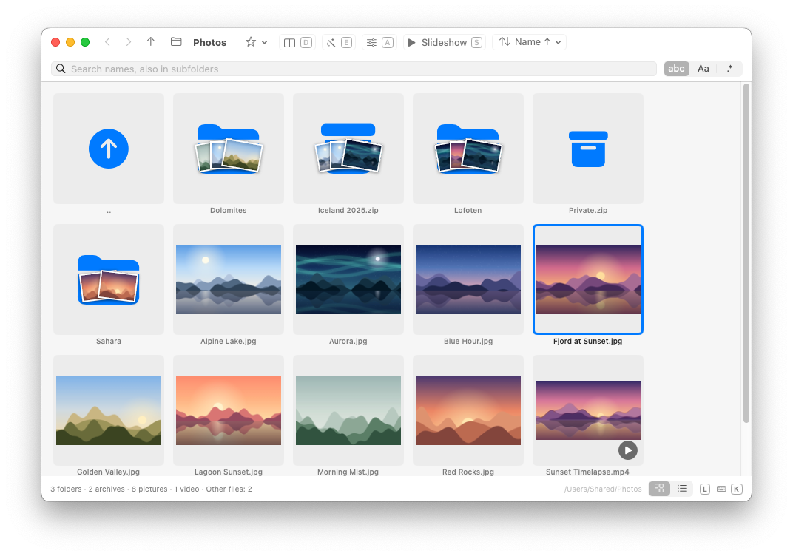
</picture></p>

One free app for the pictures and videos in your folders. Open a folder, see thumbnails, look at one picture large, page through with the keyboard. Videos play right there, too, even AVI, MKV and WebM. No library to import into, no waiting: it opens what you point it at and stays quick on big folders and network shares.

## Why Schnellbild doesn't suck

- **No ads, no tracking, no account.** It shows your pictures and talks to nobody.
- **No upselling.** No pro version, no subscription, no "unlock" button. Every feature is in.
- **No bloat.** No library to import into, no editor, no cloud.
- **Fast.** Thumbnails appear while you scroll, big folders and network shares included (see [Why so fast?](#why-so-fast)).
- **Safe by default.** Looking at pictures, videos and archives from others runs nothing and goes online nowhere, with nothing to switch on first: archives are only read, never unpacked to disk; a "video" can't make it fetch anything from the internet; a double click never starts an app hiding behind a picture's name; and the whole app runs in Apple's App Sandbox, so it reaches only the folders you open to it. What it does, and where its limit is: [Safe with files from others](#safe-with-files-from-others).
- **Provably built from this source.** Every DMG comes with a build attestation signed by GitHub: anyone can check that it was built by this repository's workflow, from a public commit. [How to check it](#provably-built-from-this-source).
- **Light or dark, your choice.** Some swear by dark mode, others can't stand it. So you decide: same as the system, light or dark (Settings, <kbd>⌘</kbd> + <kbd>,</kbd>).
- **Doesn't fall over.** Broken files, odd formats and slow disks show a placeholder, and the app keeps running. Your files are only changed when you say so: rename, trash, a new folder, or moving and copying them (dragging tiles onto a folder, <kbd>F5</kbd> / <kbd>F6</kbd> in the dual pane).

## Download

**[Schnellbild.dmg](https://github.com/JohannesHoppe/schnellbild/releases/latest/download/Schnellbild.dmg)** (macOS 15+, Apple silicon only: Macs with an Intel processor aren't supported): open it and drag Schnellbild into Applications. Signed with a Developer ID, notarized by Apple, and running in Apple's App Sandbox ([why that matters](#safe-with-files-from-others)).

**Mac App Store** (soon): the same app with every feature, for €0.99. Whoever buys it there supports its development; the DMG stays free.

Schnellbild follows your Mac's language: English, Deutsch, Français, Español, Italiano, Português (Brasil), Nederlands, Polski, Svenska, Dansk, Norsk, Suomi, Čeština, Türkçe, Русский, Українська, 日本語, 한국어, 简体中文 and 繁體中文.

## Contents

[Browse folders](#browse-folders) · [List view](#list-view) · [Atlas: map, globe, timeline, tour](#atlas-your-photos-on-the-map-and-the-globe) · [Sort](#sort) · [Search](#search-including-subfolders) · [Full view](#full-view) · [Zoom and rotate](#zoom-and-rotate) · [Slideshow and playlist](#slideshow) · [Videos](#videos) · [Finder previews](#finder-previews-for-more-videos) · [Auto enhance](#auto-enhance-and-adjustments) · [File info](#file-info) · [Rename, trash, undo](#rename-reveal-trash-sort-into-folders) · [Dual pane](#dual-pane-sort-your-holiday-photos) · [Archives](#archives-as-folders) · [Boss key](#boss-key) · [All keys at hand](#all-keys-at-hand) · [Your own keys](#your-own-keys) · [Settings](#settings) · [Accessibility](#accessibility) · [Formats](#supported-file-formats) · [Safety](#safe-with-files-from-others)

## Features

The keys are written as macOS's menus draw them: <kbd>⌘</kbd> Command, <kbd>⌥</kbd> Option, <kbd>⌃</kbd> Control, <kbd>⇧</kbd> Shift, <kbd>↩</kbd> Return, <kbd>⌫</kbd> Delete (Backspace), <kbd>⎋</kbd> Esc, <kbd>⇥</kbd> Tab, <kbd>◀</kbd> <kbd>▶</kbd> <kbd>▲</kbd> <kbd>▼</kbd> the arrows, <kbd>⤒</kbd> / <kbd>⤓</kbd> Home / End (<kbd>fn</kbd> + <kbd>◀</kbd> / <kbd>fn</kbd> + <kbd>▶</kbd> on a Mac keyboard). Keys pressed together are joined by "+", keys that do the same are separated by "/". The tables list Schnellbild's own keys; every one of them can be changed in Settings → Keyboard, also to Phiewer's keys at once ([your own keys](#your-own-keys)).

### Browse folders

- **Open** a folder with <kbd>⌘</kbd> + <kbd>O</kbd> or by dragging it onto the window; a single file dropped opens straight in the full view. Schnellbild reopens the last folder on launch (the very first launch opens Pictures).
- **Folders first**, each previewing its first pictures or videos like the Finder (from its subfolders, however deep, when it has none of its own; from an archive inside when that is all it holds), with a `..` tile to go up. Folders without a single photo or video anywhere inside are greyed out, so you don't bother opening them.
- **Three views:** <kbd>L</kbd> goes from the grid to the [list](#list-view), then to the [Atlas](#atlas-your-photos-on-the-map-and-the-globe), then back to the grid; the switch in the status bar and View → as Grid / as List / as Atlas do the same. Each half of the dual pane keeps its own view, and Schnellbild remembers it.
- **Thumbnails** come from Quick Look: JPEG, HEIC, AVIF, JPEG XL, PNG, GIF, WebP, TIFF, SVG, PDF, PSD, OpenEXR, the camera RAW formats macOS reads, and a frame for videos. An SVG or PDF Quick Look has no picture of, Schnellbild draws itself. Illustrator files, EPS and the other files Schnellbild shows by the picture they carry get that picture (see [Supported file formats](#supported-file-formats)). <kbd>+</kbd> / <kbd>−</kbd> or a trackpad pinch make them larger or smaller.
- **Always current:** what the Finder, a camera import or another app adds, renames or removes shows by itself, without the selection jumping; <kbd>⌘</kbd> + <kbd>R</kbd> reads the folder again. An ejected drive takes its windows back to the list of drives.
- **Back and forward** like a browser: <kbd>⌘</kbd> + <kbd>[</kbd> / <kbd>⌘</kbd> + <kbd>]</kbd> restore the folder, the search and the selection; <kbd>⌫</kbd> goes back to where you were. <kbd>⌘</kbd> + <kbd>▲</kbd> or `..` go up a level, and above `/` lie all drives: the Mac's own disks, external ones and network shares.
- **The path** of the folder shown sits at the bottom right of the status bar. Right-click it (or <kbd>⌃</kbd>-click) for Copy Path, Copy Path of Selected Item and Reveal in Finder; inside an archive the path runs through it (`…/Holiday.zip/Day 1`).
- **Bookmarks:** <kbd>⌘</kbd> + <kbd>D</kbd> bookmarks the folder shown (or removes its bookmark), as do the star in the toolbar, the Bookmarks menu and a folder's right-click menu; <kbd>⌃</kbd> + <kbd>1</kbd> … <kbd>⌃</kbd> + <kbd>9</kbd> open the first nine. A bookmarked folder renamed or moved in Schnellbild keeps its bookmark.
- **Several windows:** <kbd>⌘</kbd> + <kbd>N</kbd> opens another one, e.g. for a second display. Each has its own folders, dual pane and slideshow, and remembers its own last folder.
- **Hidden files** stay hidden until you want them: <kbd>⇧</kbd> + <kbd>⌘</kbd> + <kbd>.</kbd>, as in the Finder (also View → Show Hidden Files and Settings → General). Off, they appear nowhere: not in the grid, the search, slideshows or the Atlas. On, everything appears, also `.DS_Store` and the other files macOS keeps for itself, so a folder that looks empty is empty.
- **Other files** (not pictures, videos or archives) are listed by name under the grid, so a folder never looks empty when it isn't. A folder that can't be read says so, with the reason.
- **Links** count by what they point to: a link to a folder opens that folder, while renaming or trashing it acts on the link, as in the Finder.
- **Full screen** with <kbd>F</kbd> or <kbd>⌃</kbd> + <kbd>⌘</kbd> + <kbd>F</kbd>, in every view.

| Key | Action |
|---|---|
| <kbd>◀</kbd> / <kbd>▶</kbd> | previous / next item |
| <kbd>▲</kbd> / <kbd>▼</kbd> | one row up / down |
| <kbd>Space</kbd> / <kbd>F3</kbd> | open the picture or video, or enter the folder or archive |
| <kbd>⌫</kbd> | back to where you were, also to a search and its results (with no history yet: up a level) |
| <kbd>⌘</kbd> + <kbd>▲</kbd> / `..` | up one folder level; above `/` lie all drives (opened, never renamed or trashed) |
| <kbd>⌘</kbd> + <kbd>[</kbd> / <kbd>⌘</kbd> + <kbd>]</kbd> | back / forward, restoring the folder, the search and the selection |
| <kbd>⌘</kbd> + <kbd>R</kbd> | read the folder again (View → Reload) |
| <kbd>⤒</kbd> / <kbd>⤓</kbd> | first / last item |
| <kbd>+</kbd> / <kbd>−</kbd> · <kbd>⌘</kbd> + <kbd>+</kbd> / <kbd>⌘</kbd> + <kbd>−</kbd> | larger / smaller thumbnails (a trackpad pinch too) |
| <kbd>L</kbd> | the next view: grid, list, Atlas, then the grid again |
| <kbd>F</kbd> / <kbd>⌃</kbd> + <kbd>⌘</kbd> + <kbd>F</kbd> | full screen |
| <kbd>↩</kbd> / <kbd>F2</kbd> / <kbd>⇧</kbd> + <kbd>F6</kbd> | rename the selected folder or file, as in the Finder (<kbd>↩</kbd> on `..`: up a level; <kbd>F6</kbd> too in a single pane) |
| <kbd>I</kbd> / <kbd>⌘</kbd> + <kbd>I</kbd> | [file info](#file-info) beside the grid for the selected item (also Get Info in its right-click menu) |
| <kbd>D</kbd> / <kbd>⌃</kbd> + <kbd>O</kbd> | [dual pane](#dual-pane-sort-your-holiday-photos) on / off |
| <kbd>K</kbd> | [mini keyboard](#all-keys-at-hand) on / off |
| <kbd>⇧</kbd> + <kbd>⌘</kbd> + <kbd>.</kbd> | hidden files and folders on / off |
| <kbd>⌘</kbd> + <kbd>N</kbd> | a new window |
| <kbd>⌘</kbd> + <kbd>D</kbd> | bookmark the folder shown, or remove its bookmark |
| <kbd>⌃</kbd> + <kbd>1</kbd> … <kbd>⌃</kbd> + <kbd>9</kbd> | open bookmark 1 … 9 |
| <kbd>⌘</kbd> + <kbd>A</kbd> / <kbd>⎋</kbd> | mark all / unmark; <kbd>⎋</kbd> with nothing marked clears the search |
| <kbd>M</kbd> / <kbd>Insert</kbd> | mark or unmark the selected item and move on to the next |
| <kbd>X</kbd> | [boss key](#boss-key) on |

### List view

<p align="center"><picture>
  <source media="(prefers-color-scheme: dark)" srcset="docs/screenshots/list-dark.webp">
  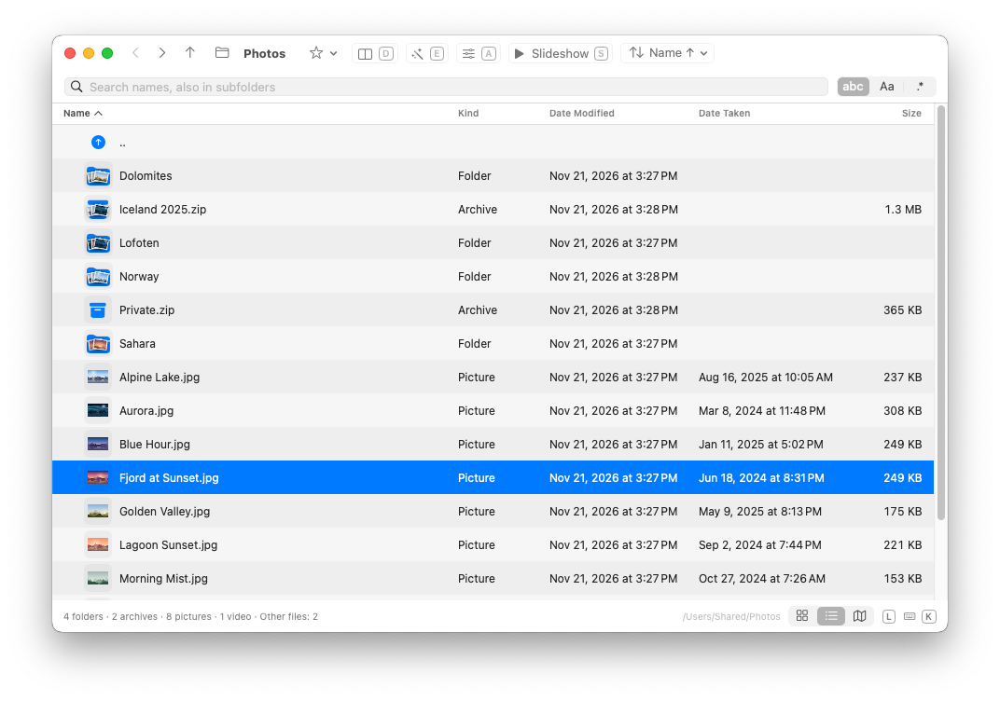
</picture></p>

<kbd>L</kbd> (or the switch in the status bar) shows the folder as a list: a small preview (for a folder, its first pictures fanned out as on its tile), the whole name, kind, date modified, date taken and size in columns, and while sorting by distance how far away each one was taken. A click on a column's header sorts by it, another reverses it, the same sort as the sort menu. Everything else works as in the grid: clicking, marking, dragging, opening.

### Atlas: your photos on the map and the globe

<p align="center"><picture>
  <source media="(prefers-color-scheme: dark)" srcset="docs/screenshots/atlas-dark.webp">
  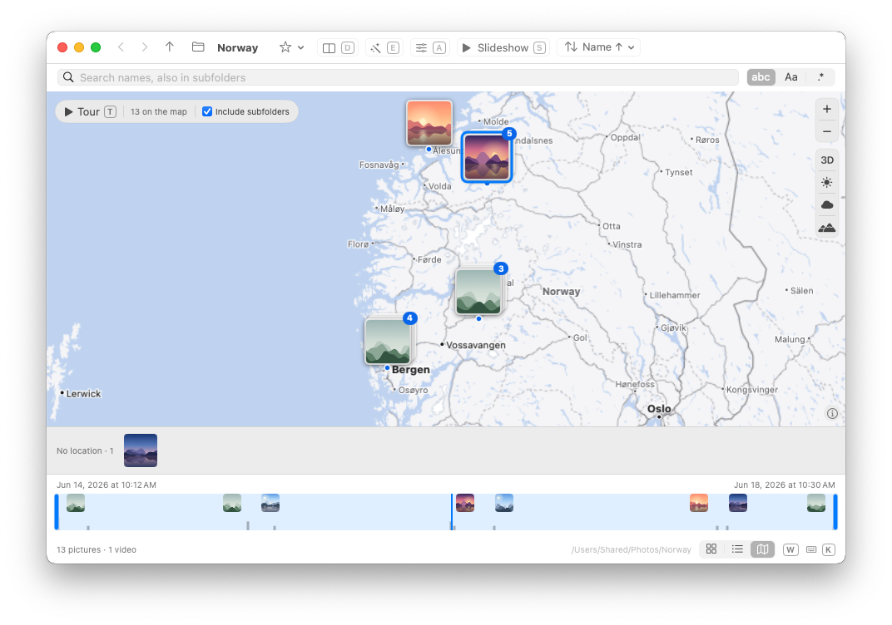
</picture></p>

<kbd>L</kbd> after the list (or the map in the status bar's switch, or View → as Atlas) shows the folder's photos and videos where they were taken, on the map inside Schnellbild: a thumbnail at each place, and where several lie close together one tile with their number, which parts as you zoom in.

- **The map and the globe:** zoomed far out the map is a globe in front of the stars, from satellite pictures; it flattens into the map as you zoom in. Drag or scroll to move the map or turn the globe (a drag thrown keeps it turning a moment), pinch, <kbd>⌘</kbd>-scroll, a double click or <kbd>+</kbd> / <kbd>−</kbd> to zoom.
- **Its buttons:** <kbd>+</kbd> / <kbd>−</kbd>; **tilt** towards the horizon (also <kbd>⌥</kbd>-drag or <kbd>⌥</kbd> with two fingers; turning two fingers turns the view), and back to straight down with north up; **day and night**, lit by the Sun as it stood when the photo was taken (in the tour) or as it stands now, with the cities lit on the night side; **clouds**; the **relief** exaggerated, so mountains and fjords stand out, or at its true scale.
- **Tilted, all the way in:** zooming in closer than low orbit the view straightens by itself into the flat map, and zooming out again it tilts back.
- **With the subfolders:** it shows the photos and videos of every subfolder too (archives included, hidden folders only while hidden files are shown), as the slideshow plays them; they come in while the subfolders are read, and "Include subfolders" over the map turns that off (Schnellbild remembers it). While you search, it shows the results.
- **One selection:** a click selects, the same item as in the grid and the list; one from a subfolder selects the folder it lies in there, and a folder selected in the grid hands the selection to its first photo in the Atlas. <kbd>Space</kbd> or a double click opens it, and the full view opened from the Atlas goes on from folder to folder. A double click on a tile of several zooms in until they part; the arrow keys go to the nearest tile that way.
- **Photos taken at the very same place** stay one tile however far you zoom in: each click on it selects the next of them, as do <kbd>▶</kbd> and <kbd>◀</kbd>.
- **Without a location:** photos and videos without one wait in a strip under the map ("No location · 12"), to select and open like the others; none gets a made-up place.

<p align="center"><picture>
  <source media="(prefers-color-scheme: dark)" srcset="docs/screenshots/atlas-globe-near-dark.webp">
  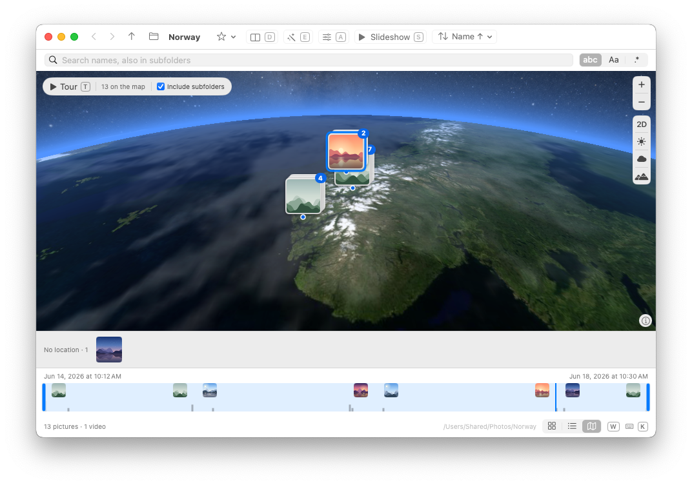
</picture></p>

The **timeline** at the bottom lays everything out by the time it was taken, a bar for each stretch of time with a thumbnail now and then. Drag across it, or move one of its handles, and the map and the strip show only that part of the trip; Show All brings back the whole span. A click on the timeline selects the photo taken nearest that moment. Times are those of the clock where each photo was taken, also when your Mac is in another time zone, and a video whose file only knows the time in UTC gets the offset of the photos around it.

The **tour** (<kbd>T</kbd>, the Tour button over the map, or View → Play Tour) plays the trip back in full screen: the photos and videos are grouped into places (the same day, within about a kilometre), the map glides from one to the next in the order of time, the route grows on the map in the accent colour (along a GoPro's or DJI drone's GPS track where a video has one), and at each place its photos show large one after another while a video (also an MKV or another format only VLC plays) plays a few seconds without sound. The day, the place's name and "Place 3 of 8" show along. It keeps to the part of the timeline you chose. With Reduce motion on, the map cuts from place to place.

<p align="center"><picture>
  <source media="(prefers-color-scheme: dark)" srcset="docs/screenshots/tour-dark.webp">
  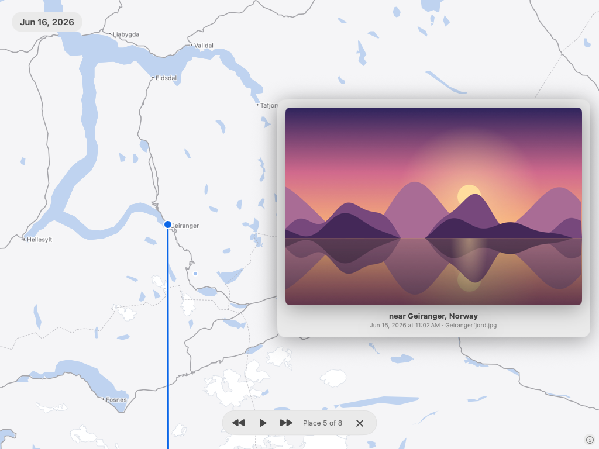
</picture></p>

**Where the places come from:** the same sources as sorting by date taken and by distance (EXIF, a phone's video, a GoPro's telemetry, a DJI flight log, a Sony clip file, XMP sidecars, GPX tracks in the folder; see [File info](#file-info)), read in the background; with tens of thousands of photos the map fills in while they are read, one photo of every folder first, so every place shows early, then the folders you are looking at. The map is OpenStreetMap data inside the app: nothing is uploaded, no location leaves your Mac, and Schnellbild doesn't go online for it.

| Key | Action |
|---|---|
| <kbd>L</kbd> | from the list: the Atlas; from the Atlas: back to the grid |
| <kbd>◀</kbd> / <kbd>▶</kbd> / <kbd>▲</kbd> / <kbd>▼</kbd> | to the nearest item on the map that way; down into the strip of items without a location |
| <kbd>Space</kbd> / double-click | open the item; on a tile of several, a double click zooms in |
| click | on a tile of photos taken at one place: the next of them (<kbd>▶</kbd> / <kbd>◀</kbd> too) |
| <kbd>+</kbd> / <kbd>−</kbd> | zoom the map in / out |
| <kbd>⤒</kbd> / <kbd>⤓</kbd> | the first / last item in time |
| <kbd>T</kbd> | play the tour |
| <kbd>Space</kbd> | in the tour: pause / resume |
| <kbd>◀</kbd> / <kbd>▶</kbd> | in the tour: previous / next place |
| <kbd>⎋</kbd> / <kbd>T</kbd> | end the tour |

### Sort

<p align="center"><picture>
  <source media="(prefers-color-scheme: dark)" srcset="docs/screenshots/sort-dark.webp">
  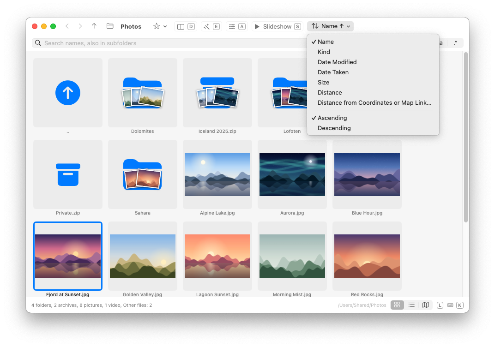
</picture></p>

By name, kind, date modified, date taken, size or distance, from the toolbar's sort menu (with Ascending / Descending) or with one key. The same key again reverses the order. Date taken reads the camera's capture date (EXIF with its offset from UTC, an XMP sidecar, the video's creation date, a GoPro's GPS time, a DJI drone's flight log, a Sony camera's clip file), so copied photos still line up in the order they were shot. Dates and sizes start newest and largest first, like Finder. Schnellbild remembers the order.

**By distance:** the photos and videos taken nearest to a place come first, those without a location last. The place is a photo's own (right-click it: Sort by Distance from Here, or the button in its file info), or coordinates you paste: `48.137, 11.575`, `48.137° N 11.575° E`, `48°8′14″N 11°34′27″E`, or a link from Apple Maps, Google Maps or OpenStreetMap (Sort → Distance from Coordinates or Map Link…). The sheet shows what it read and the town nearby; a click on its map picks a place, and **Use My Location** takes where your Mac is: macOS asks you the first time, Schnellbild asks for the position only on that click, once, and it never leaves your Mac. It works in a folder and in search results from all its subfolders; the locations are read once and kept while a file and the files beside it stay the same, with a progress count in the status bar for many files. Choosing another sort stops it. The list view shows each distance, a tile its tooltip, in kilometres or miles as your region uses them.

<p align="center"><picture>
  <source media="(prefers-color-scheme: dark)" srcset="docs/screenshots/distance-dark.webp">
  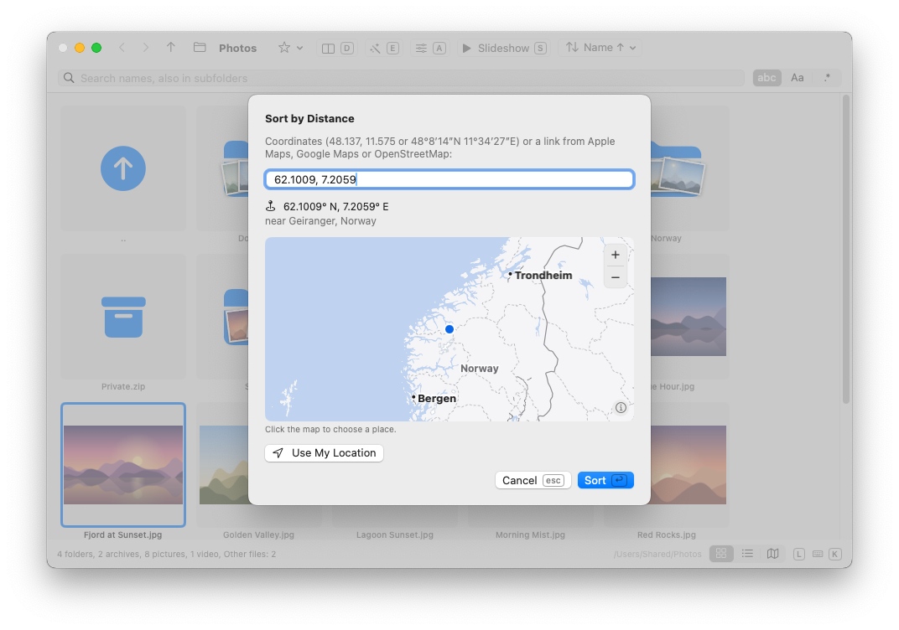
</picture></p>

| Key | Action |
|---|---|
| <kbd>⌘</kbd> + <kbd>1</kbd> … <kbd>⌘</kbd> + <kbd>6</kbd> | sort by name, kind, date modified, date taken, size, distance (again: reverse) |

### Search, including subfolders

<p align="center"><picture>
  <source media="(prefers-color-scheme: dark)" srcset="docs/screenshots/search-dark.webp">
  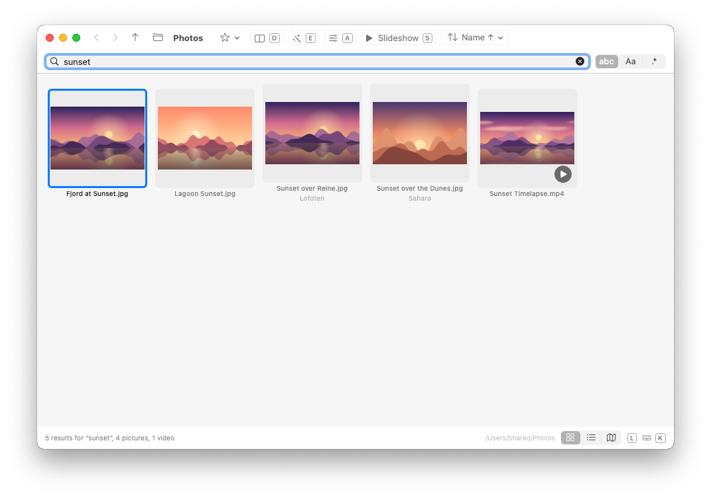
</picture></p>

- **Always there:** the search field matches the names of folders, archives, pictures and videos in the current folder and everything below it. Results stream in while it searches, even on a slow network share, and show where they live; the stop button keeps what was found.
- **Three ways to match**, by the switch beside the field: `abc` ignores case, `Aa` matches it, `.*` takes a regular expression (`^`, `$`, `(?i)` work as usual). Each half of the dual pane remembers its choice.
- **Back** from an opened result returns to the same results without searching again; a search still running goes on in the background.
- **Search results play** as a slideshow and show in the Atlas, the results instead of the folder.

| Key | Action |
|---|---|
| <kbd>⌘</kbd> + <kbd>F</kbd> | focus the search field |
| <kbd>▼</kbd> | move into the results |
| <kbd>↩</kbd> | open the selected result |
| <kbd>⎋</kbd> | clear the search; once more: leave the field |

### Full view

<p align="center"><picture>
  <source media="(prefers-color-scheme: dark)" srcset="docs/screenshots/full-dark.webp">
  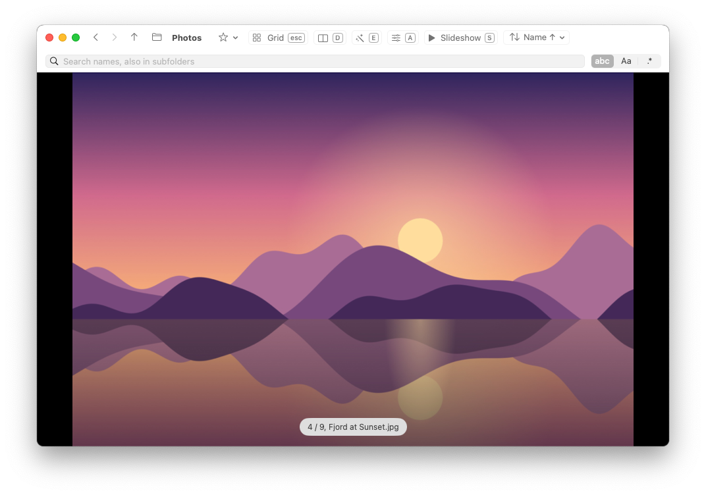
</picture></p>

One picture, as large as the window allows, with its position in the folder. The full image is sampled to screen size, the thumbnail shows instantly until it's there, and in full screen it is read again sharper. Animated GIFs, PNGs and WebPs play, and zoom, turn and take the enhance filter like any photo. SVGs are drawn sharp at every zoom.

**PDFs, page by page.** A PDF shows one page at a time, drawn sharp at every zoom. <kbd>◀</kbd> / <kbd>▶</kbd> turn the pages as they skim a video: past the last page on to the next item, before the first back to the previous one; <kbd>⌘</kbd> + <kbd>◀</kbd> / <kbd>⌘</kbd> + <kbd>▶</kbd> go to the previous / next item at once. The badge shows the page ("Page 3 / 12"). Each page starts at fit and upright and is zoomed, moved and turned on its own. Its tile shows the first page, and the slideshow shows that page as one item. Links, form fields and scripts in a PDF do nothing: Schnellbild only draws the pages. Illustrator files saved with PDF content show the same way.

| Key | Action |
|---|---|
| <kbd>◀</kbd> / <kbd>▶</kbd> | previous / next picture; on a PDF its previous / next page (on a video: see [Videos](#videos)) |
| <kbd>⌘</kbd> + <kbd>◀</kbd> / <kbd>⌘</kbd> + <kbd>▶</kbd> | previous / next item, also from a video or PDF |
| <kbd>▲</kbd> / <kbd>▼</kbd> | pictures zoomed in: look further up / down; videos: volume up / down |
| <kbd>Space</kbd> | next picture; on a video: play / pause |
| <kbd>F2</kbd> | rename the picture or video shown |
| <kbd>⎋</kbd> / <kbd>⌫</kbd> / <kbd>↩</kbd> | back to the grid, at the same place |

### Zoom and rotate

<p align="center"><picture>
  <source media="(prefers-color-scheme: dark)" srcset="docs/screenshots/zoom-dark.webp">
  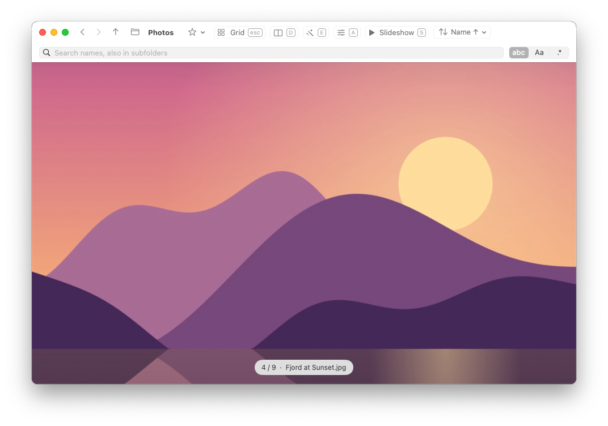
</picture></p>

Zoom with the keyboard or a trackpad pinch, drag to pan, rotate in steps of 90°, for photos and videos alike, also in the slideshow. Zooming keeps the middle of the view where it is, and a zoomed-in picture is read again at the sharper size. Only the view changes; Schnellbild never modifies your files.

| Key | Action |
|---|---|
| <kbd>+</kbd> / <kbd>−</kbd> · <kbd>⌘</kbd> + <kbd>+</kbd> / <kbd>⌘</kbd> + <kbd>−</kbd> | zoom in / out |
| <kbd>0</kbd> / <kbd>1</kbd> | fit to window / a photo's real size (100 %; a photo smaller than the window stays fitted, a video always) |
| <kbd>⌥</kbd> + <kbd>◀</kbd> / <kbd>⌥</kbd> + <kbd>▶</kbd> | rotate left / right |

### Slideshow

<p align="center"><picture>
  <source media="(prefers-color-scheme: dark)" srcset="docs/screenshots/slideshow-dark.webp">
  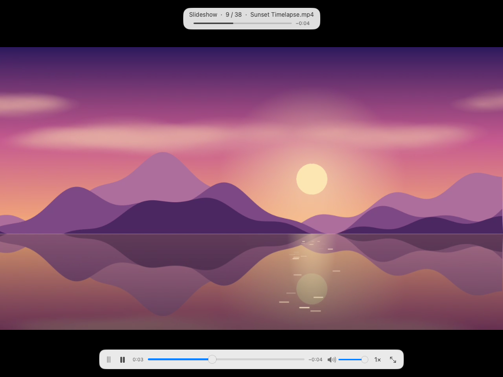
</picture></p>

Schnellbild has two ways of looking at a folder: **browse** it in the grid, or sit back and watch a **slideshow** of everything in it. The slideshow plays every photo and video in the folder **and all its subfolders** (archives included), in full screen, folder by folder in the sort order you chose. The sort order applies within each folder and to the order of the subfolders: sorted by name, folders like `Day 1`, `Day 2` … play one after the other; sorted by date taken, the pictures in each folder play in the order they were shot. Pictures stay three seconds (Settings, <kbd>⌘</kbd> + <kbd>,</kbd> sets 1 to 60), videos play to their end, then it moves on. It starts at once, while the subfolders are still being read; until then the count at the top says "so far" ("3 / 57 so far").

Three ways to start it:

- **▶︎ Slideshow** in the toolbar, or <kbd>S</kbd>: plays the folder you're in, with everything below it. While you search, it plays the search results instead.
- **Right-click a folder tile → Start Slideshow of This Folder:** plays only that folder (and its subfolders), without opening it first.
- **Drag a folder onto the window:** the window splits into two halves. Drop it on **Browse** to look around in the grid, or on **Slideshow** to start the show straight away. A single dropped picture starts the slideshow of its folder at that picture.

It starts where you are: from the full view at the picture you're looking at; in the grid at the file you selected, or at the first picture inside the folder you selected (also deep in the subfolders), and goes on from there, round to the start at the end. <kbd>⎋</kbd> ends it and brings you back to where you were.

**A playlist on the fly.** There are no playlists to build: whatever the slideshow plays (the folder and its subfolders, the search results, an archive) is the playlist. Press <kbd>P</kbd> during the show and its list slides in from the right, every photo and video in the order it plays, each with its preview and name, the one on screen marked. Drag an item to where it should play, click one to jump to it, or take one out with <kbd>⌫</kbd> or its right-click menu (after a click in the list; the file stays where it is). While the subfolders are still being read, what they bring keeps coming in, and what you moved or took out stays that way. The list lies over the picture; the pin at its top right gives it a place of its own beside the picture, and its left edge drags it wider or narrower (a double-click: the standard width). Schnellbild remembers the pin and the width; the list itself ends with the show. <kbd>⎋</kbd> closes the playlist first, then the show.

<p align="center"><picture>
  <source media="(prefers-color-scheme: dark)" srcset="docs/screenshots/playlist-dark.webp">
  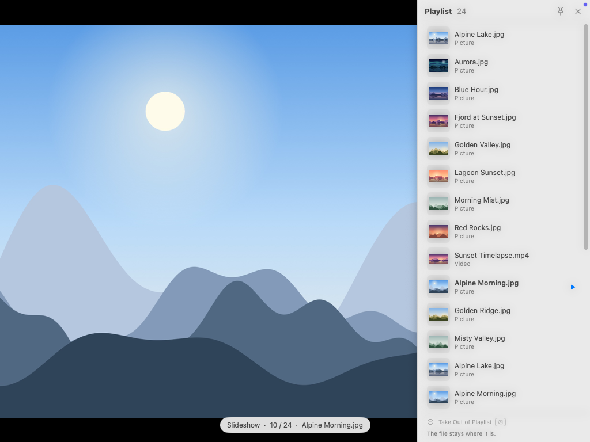
</picture></p>

| Key | Action |
|---|---|
| <kbd>S</kbd> | start the slideshow (again: end it) |
| <kbd>P</kbd> | show / hide the playlist |
| <kbd>▲</kbd> / <kbd>▼</kbd> · <kbd>↩</kbd> · <kbd>⌫</kbd> | in the playlist, after a click in it: choose an item · show it · take it out of the playlist (the file stays) |
| <kbd>Space</kbd> | pause / resume |
| <kbd>◀</kbd> / <kbd>▶</kbd> | previous / next picture; in a video 10 % of its length back / ahead |
| <kbd>⇧</kbd> + <kbd>◀</kbd> / <kbd>⇧</kbd> + <kbd>▶</kbd> | in a video 1 % of its length back / ahead |
| <kbd>⌘</kbd> + <kbd>◀</kbd> / <kbd>⌘</kbd> + <kbd>▶</kbd> | previous / next item |
| <kbd>▲</kbd> / <kbd>▼</kbd> | pictures zoomed in: look further up / down; videos: volume up / down |
| <kbd>F</kbd> / <kbd>I</kbd> / <kbd>E</kbd> / <kbd>A</kbd> | full screen, file info, auto enhance, sliders, as in the full view |
| <kbd>V</kbd> / <kbd>⌃</kbd> + <kbd>⌘</kbd> + <kbd>S</kbd> / <kbd>⌃</kbd> + <kbd>⌘</kbd> + <kbd>A</kbd> / <kbd>&lt;</kbd> / <kbd>&gt;</kbd> | subtitles, audio track and speed of a video, as in the full view |
| <kbd>⎋</kbd> / <kbd>↩</kbd> / <kbd>⌫</kbd> | end the slideshow (with the playlist open: close the playlist first) |

### Videos

<p align="center"><picture>
  <source media="(prefers-color-scheme: dark)" srcset="docs/screenshots/video-dark.webp">
  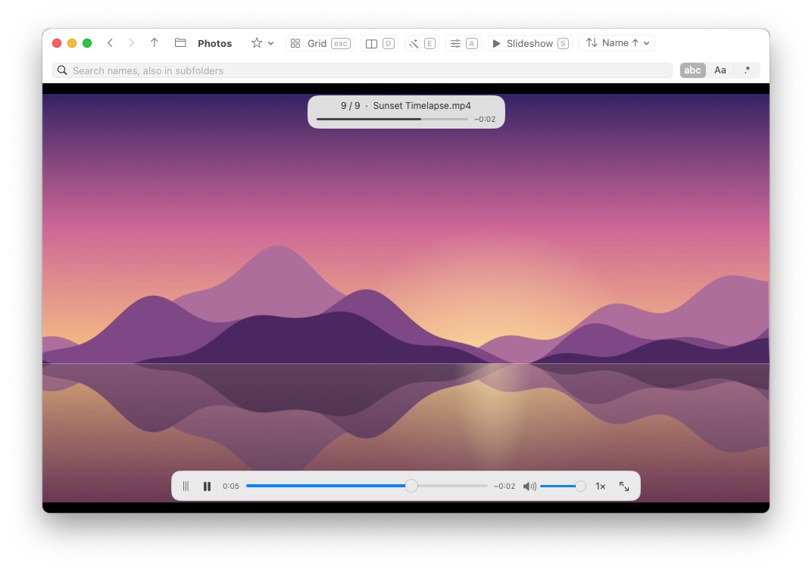
</picture></p>

- **Everything plays:** MP4 and MOV through macOS itself, what macOS can't play (AVI, MKV, WebM, DVD's VOB …) through the VLC engine built in. Media Extensions you turned on in System Settings are used too.
- **HDR** videos (PQ and HLG) show in their full brightness on a display that can show it, through either engine.
- **The arrow keys skim:** each press jumps a tenth of the video, <kbd>⇧</kbd> a hundredth, past the end on to the next item. So one key pages through photos and skims through videos; <kbd>⌘</kbd> + <kbd>◀</kbd> / <kbd>⌘</kbd> + <kbd>▶</kbd> skip a video at once.
- **Back where you left it:** halfway through a video, <kbd>⌘</kbd> + <kbd>▶</kbd> shows what the next one brings, and <kbd>⌘</kbd> + <kbd>◀</kbd> takes you back to the place you left, playing or paused as you left it. The same when you open it again from the grid. A video watched to its end starts from the beginning. The places last as long as you stay in the folder: open another one, and back here every video starts from the beginning again.
- **A thin bar** under the badge at the top shows how far the video has played and the time left.
- **One control bar for every video**, whichever engine plays it: play and pause, the position to drag, the time played and left, volume, speed, subtitles and the audio track (where the video has more than one), full screen. It shows while the mouse moves over the video and goes after a few seconds of rest, never dimming the picture; with VoiceOver on it stays. Drag it by its grip wherever it suits you: it stays there for every video, also after a restart, and a double click on the grip (or Video → Reset Control Bar Position) puts it back at the bottom. On a zoomed or turned video it stays upright.
- **<kbd>▲</kbd> / <kbd>▼</kbd> set the volume** of every video, kept for the next launch.
- **Subtitles inside the video** (MKV with SubRip, ASS or PGS, MP4 and MOV with text tracks): on or off with <kbd>V</kbd>, the next track with <kbd>⌃</kbd> + <kbd>⌘</kbd> + <kbd>S</kbd>. They show from the first line; switched on halfway, the line already running appears at once, and ASS subtitles keep their position, colours and fonts. On and off and the language you chose last are kept for every video. Subtitle files lying next to a video are never loaded, nothing is fetched from the internet.
- **Audio tracks:** a video with several (languages, a commentary) switches with <kbd>⌃</kbd> + <kbd>⌘</kbd> + <kbd>A</kbd> or from the control bar, which names each track's language; the language is kept for the next video.
- **Speed:** <kbd>&lt;</kbd> and <kbd>&gt;</kbd> play slower or faster in steps from 0.5× to 2×, the voices keeping their pitch; <kbd>⌘</kbd> + <kbd>\\</kbd> is normal speed again. The badge shows the speed while it isn't 1×; it holds for every video until Schnellbild quits. In the dual pane the other half's video follows.
- **Right-click the video** for subtitles, audio track and speed; the Video menu has them too.
- **Zoom, turn, enhance:** videos zoom, pan, rotate and take [auto enhance](#auto-enhance-and-adjustments) like photos.

| Key | Action |
|---|---|
| <kbd>Space</kbd> | play / pause |
| <kbd>◀</kbd> / <kbd>▶</kbd> | 10 % of the length back / ahead; at the end on to the next item, at the start back to the previous one |
| <kbd>⌘</kbd> + <kbd>◀</kbd> / <kbd>⌘</kbd> + <kbd>▶</kbd> | previous / next item straight away; a video you come back to goes on where you left it (in the same folder) |
| <kbd>▲</kbd> / <kbd>▼</kbd> | volume up / down in tenths, for every video, remembered (shown while it changes) |
| <kbd>⇧</kbd> + <kbd>◀</kbd> / <kbd>⇧</kbd> + <kbd>▶</kbd> | 1 % of the length back / ahead, to find a place exactly |
| <kbd>V</kbd> | subtitles on / off (remembered) |
| <kbd>⌃</kbd> + <kbd>⌘</kbd> + <kbd>S</kbd> | next subtitle track, then none |
| <kbd>⌃</kbd> + <kbd>⌘</kbd> + <kbd>A</kbd> | next audio track |
| <kbd>&lt;</kbd> / <kbd>&gt;</kbd> | slower / faster (0.5×, 0.75×, 1×, 1.25×, 1.5×, 2×) |
| <kbd>⌘</kbd> + <kbd>\\</kbd> | normal speed |

<p align="center"><picture>
  <source media="(prefers-color-scheme: dark)" srcset="docs/screenshots/volume-dark.webp">
  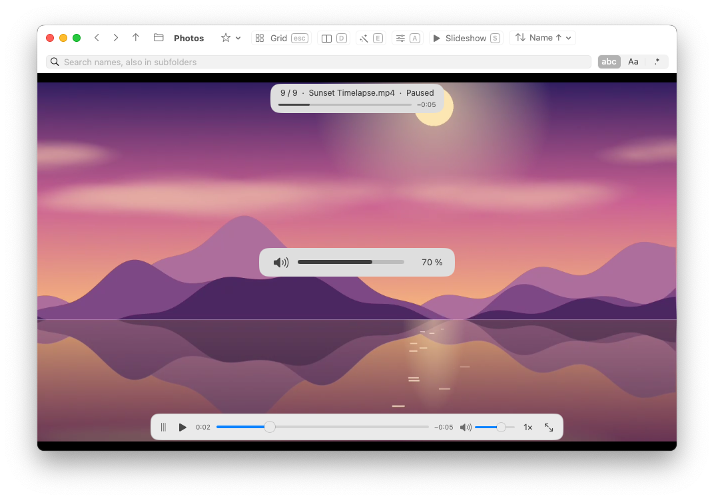
</picture></p>

### Finder previews for more videos

macOS shows many video formats as plain icons, in the Finder too. Schnellbild teaches macOS some of them: it brings a Quick Look extension that takes a frame from such a video. The Finder and Schnellbild's grid then show a picture, and macOS keeps it in its own thumbnail cache, so a video on a network share is read once, not on every visit.

- Formats: MKV, WebM, WMV, ASF, FLV, Ogg video and DVD video (`.vob`). What macOS reads itself (MP4, MOV, MPEG, …) stays with macOS.
- Downloads still in progress (`film.mp4.part`, `photo.jpg.crdownload` …) get a picture too, as far as their data reaches.
- AVI stays an icon in the Finder: macOS hands it to its own extension, not to Schnellbild's. AVCHD camcorder clips (`.mts`, `.m2ts`) get their Finder picture through the media extension below (macOS 26). Schnellbild's grid shows a picture for both either way.
- Works whether Schnellbild is open or not: macOS starts the extension when a picture is needed and ends it afterwards. It is known to macOS once Schnellbild has been opened, and goes away with the app.
- Runs in Apple's App Sandbox: no network, and it may read only the one file macOS hands it.
- Can be switched off in System Settings → General → Login Items & Extensions → Quick Look. Schnellbild then draws these tiles itself, for as long as it runs.

Schnellbild also brings a **media extension**, "Schnellbild Video Formats": it teaches macOS itself to read MKV videos and AVCHD camcorder clips (`.mts`, `.m2ts`; H.264 and HEVC video). Turned on, the Finder and Schnellbild get their thumbnails straight from macOS on macOS 26, the fastest way and kept by macOS. It reads only as much of a file as the picture needs, so a long clip on a network share costs a few megabytes, not the whole file. It is off until you turn it on under System Settings → General → Login Items & Extensions → Media Extensions; Schnellbild → Settings shows whether it is on and opens that page. Like the Quick Look extension it runs in the App Sandbox and reads only the file macOS hands it. Off, or on macOS 15, everything works as described above.

### Auto enhance and adjustments

Night shots and dark videos, or washed-out, overexposed ones: press <kbd>E</kbd> (or the wand in the toolbar) and Schnellbild sets four values for the picture on screen:

- **Exposure:** brightens dark material and tones down overexposed material.
- **Contrast:** stretches flat, hazy pictures.
- **Saturation:** lifts washed-out colours and calms garish ones.
- **Sharpness:** crisper edges, like an unsharp mask.

<p align="center"><picture>
  <source media="(prefers-color-scheme: dark)" srcset="docs/screenshots/adjust-dark.webp">
  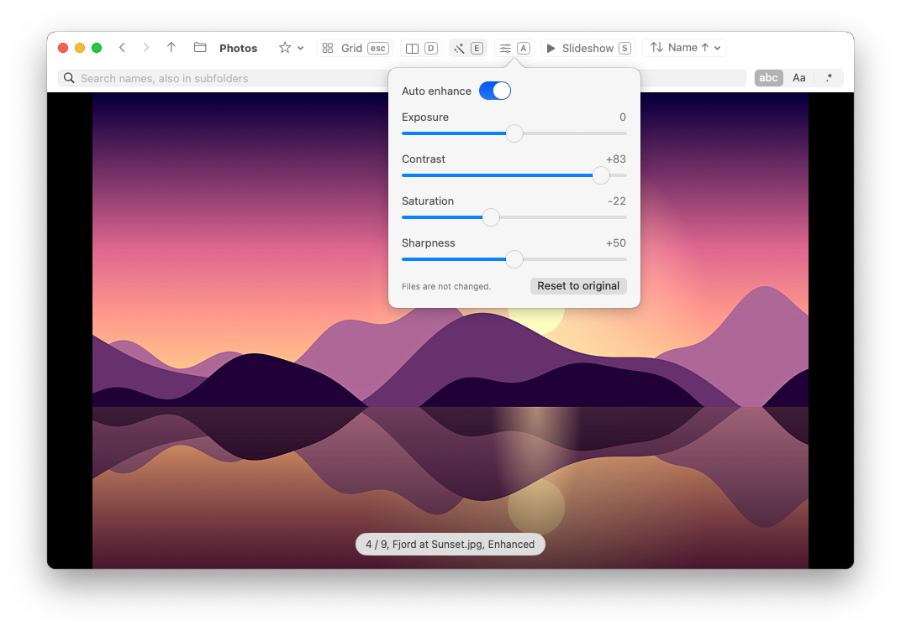
</picture></p>

Press <kbd>A</kbd> (or the sliders button next to the wand) to see these values. With auto enhance on, the sliders show what it sets for each photo, and for videos they move with the scenes. Videos are measured once a second, and the values glide instead of jumping, so a dark intro or a cut doesn't throw them and nothing flickers. After you skip, they're measured again at once.

When auto gets a picture wrong, move a slider. Auto enhance switches off and you carry on from its values. Your settings stay while you page on, until you reset them (Reset to original) or switch auto enhance on again. Switching it off shows the files as they are.

It's a filter on the screen only: your files stay as they are. Photos and videos of every format go through the same filter, so the sliders work the same everywhere, at once.

| Key | Action |
|---|---|
| <kbd>E</kbd> | auto enhance on / off |
| <kbd>A</kbd> | show / hide the sliders (<kbd>⎋</kbd> hides them too) |

### File info

<p align="center"><picture>
  <source media="(prefers-color-scheme: dark)" srcset="docs/screenshots/inspector-dark.webp">
  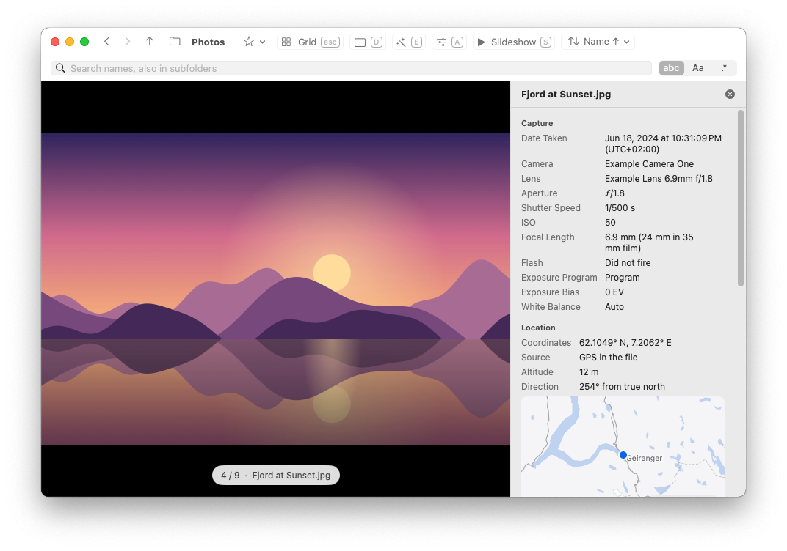
</picture></p>

A sidebar with everything a file says about itself, for the item selected in the grid or list, or the one on screen in the full view and the slideshow (<kbd>I</kbd>, <kbd>⌘</kbd> + <kbd>I</kbd>, Actions → Get Info, or Get Info in an item's right-click menu):

- **Capture:** date and time as the camera's clock showed them, with its offset from UTC, and where they come from when it isn't the file's own capture date (an XMP sidecar, a GoPro's GPS time, a DJI drone's flight log, a Sony camera's clip file, the video's header in UTC); camera, lens, aperture, shutter speed, ISO, focal length (and its 35 mm equivalent), flash, exposure program and bias, white balance, orientation.
- **Location:** latitude and longitude (`48.1372° N, 11.5761° E`), altitude, the direction the camera faced and where the place comes from: a photo's GPS data, the location a phone writes into a video (iPhone, Android), a GoPro's GPS track (its first good fix; for the video also the route's length), a DJI drone's flight log beside the video (`DJI_0001.SRT`), a Sony camera's clip file (`C0001M01.XML`), XMP inside a video, or an XMP sidecar from Lightroom, darktable and others (`IMG_0001.xmp`, `IMG_0001.CR2.xmp`), which comes first. A photo or video without a place of its own is placed on a GPX track in the same folder by the time it was taken, within five minutes of a point of the track; it says so ("From GPX track walk.gpx", with the time to the nearest point), and the file stays as it is. How exact the place is, where the source states it (GPS error in metres, GoPro's dilution of precision). A small map around the place and the town nearby ("near Geiranger, Norway") come from the map data inside Schnellbild, without going online. **Sort by Distance from Here** sorts the folder from this place. **Open in Maps** shows the place in Apple Maps; that app goes online, Schnellbild itself doesn't.
- **Picture or video:** resolution, colour space and profile, bit depth, HDR (PQ, HLG, a gain map, Dolby Vision); for a video its codecs (video with frames per second, audio with channels and sample rate), its tracks, length and bitrate. MKV, WebM and the other formats only VLC plays show what VLC reports once they play in the full view.
- **File:** kind, format by content, size, created, modified and where it lies.
- **All metadata:** every key of the EXIF, GPS, TIFF, IPTC, maker and XMP data (QuickTime metadata for videos), in groups to fold open, with a filter. Values can be selected and copied (right-click: Copy), and Copy All puts everything on the clipboard as text. Large values such as maker notes are shortened.

Only the file's header and the files beside it are read, in the background, also for pictures inside archives (there, the header alone).

A file whose extension names another format than its content (a recording named `.mkv` that is really an MPEG transport stream, a PNG named `.jpg`) gets a note with the extension that fits. Schnellbild shows it anyway, by its content. For a download that isn't finished, the File section says so, and whether the file is still growing.

| Key | Action |
|---|---|
| <kbd>I</kbd> / <kbd>⌘</kbd> + <kbd>I</kbd> | show / hide the file info |

### Rename, reveal, trash, sort into folders

<p align="center"><picture>
  <source media="(prefers-color-scheme: dark)" srcset="docs/screenshots/rename-dark.webp">
  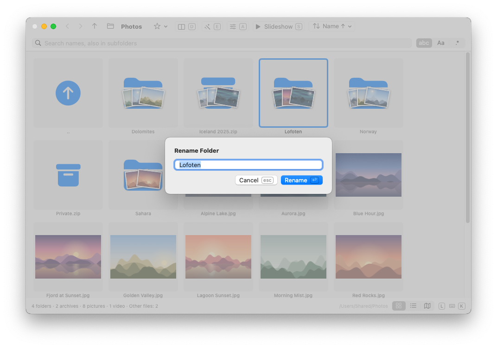
</picture></p>

- **Rename** with <kbd>↩</kbd> or <kbd>F2</kbd> (as in the Finder), also from the full view, the Actions menu or a right-click. The folder you're in is renamed by clicking its name in the title bar. A file keeps an extension Schnellbild shows.
- **Sort into folders:** <kbd>⇧</kbd> + <kbd>⌘</kbd> + <kbd>N</kbd> makes a new folder, then drag tiles onto a folder, or onto `..` to move them up a level. On the same disk they move, onto another they're copied. A name that's taken asks: keep both, skip or cancel, once or for all. The status bar shows while files are being copied or moved.
- **Undo** renaming, trashing (folders, marked items and archives with all their parts too), moving, copying and new folders, as often as you like: Edit → Undo, <kbd>⌘</kbd> + <kbd>Z</kbd>, or the top of the right-click menu ("Undo Move to Trash"); <kbd>⇧</kbd> + <kbd>⌘</kbd> + <kbd>Z</kbd> redoes. While you type in a field, <kbd>⌘</kbd> + <kbd>Z</kbd> undoes the typing.
- **Safe by design:** a copy gets its real name only when it's complete, so an interrupted one never leaves a cut-off file. Undo touches only what Schnellbild itself did, never a different file that took the same name. An Undo that can't be carried out (the Trash emptied, the name taken meanwhile) says why and leaves the item where it is, in the Trash too. Inside archives nothing is changed. Quitting while files are still being copied or moved asks first and can wait until they are done.
- **Other files** (anything that isn't a picture, video or archive) are listed under the grid: rename, trash or drag them like tiles; a double click opens documents (text, PDF, office, audio) in their app, but never apps, scripts, installers, disk images or web pages.
- Reveal in Finder, open with the default app, move to the Trash (it asks first, with the names), or drag tiles to the Finder or another app.

| Key | Action |
|---|---|
| <kbd>↩</kbd> / <kbd>F2</kbd> | rename the selected folder or file (<kbd>F2</kbd> also in the full view) |
| <kbd>⇧</kbd> + <kbd>⌘</kbd> + <kbd>N</kbd> / <kbd>F7</kbd> | new folder: type its name, <kbd>↩</kbd> creates it, <kbd>⎋</kbd> creates none |
| <kbd>⇧</kbd> + <kbd>⌘</kbd> + <kbd>R</kbd> | reveal in Finder |
| <kbd>⌘</kbd> + <kbd>↩</kbd> / <kbd>F4</kbd> | open with the default app |
| <kbd>⌘</kbd> + <kbd>⌫</kbd> / <kbd>F8</kbd> | move to Trash |
| <kbd>⌘</kbd> + <kbd>Z</kbd> / <kbd>⇧</kbd> + <kbd>⌘</kbd> + <kbd>Z</kbd> | undo / redo renaming, trashing, moving, copying, a new folder |

<p align="center"><picture>
  <source media="(prefers-color-scheme: dark)" srcset="docs/screenshots/newfolder-dark.webp">
  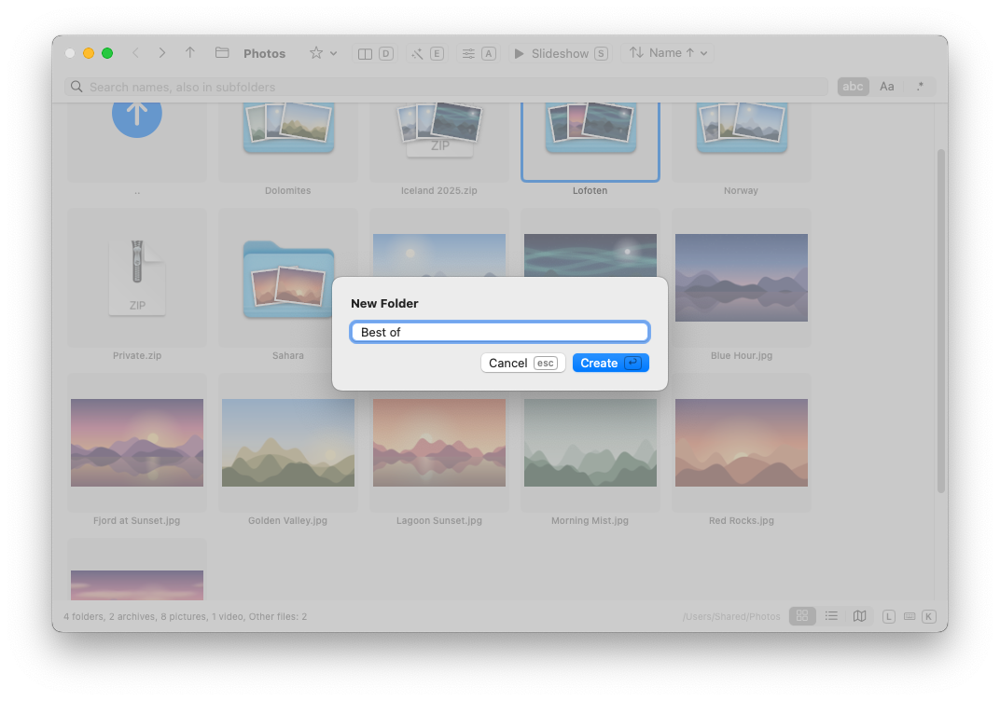
</picture></p>

### Dual pane: sort your holiday photos

<p align="center"><picture>
  <source media="(prefers-color-scheme: dark)" srcset="docs/screenshots/dualpane-dark.webp">
  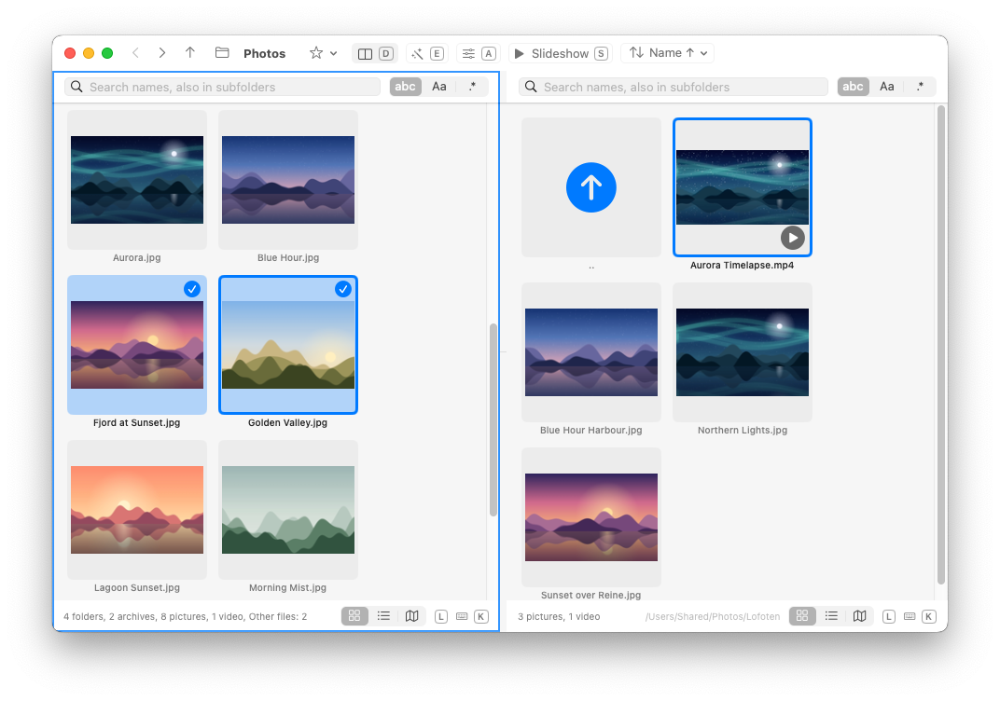
</picture></p>

**Dual Pane** in the toolbar (or <kbd>D</kbd>) splits the window in two, like the classic two-panel file managers:

- **Two browsers side by side,** each with its own folder, search, history, view and sort order. The outlined one gets the keys, <kbd>⇥</kbd> switches. Drag the line between them to share the room differently (double-click: half and half); Schnellbild remembers both.
- **Mark** with <kbd>⌘</kbd>-click, <kbd>⇧</kbd>-click or <kbd>⇧</kbd> + arrows (<kbd>⌘</kbd> + <kbd>A</kbd> all, <kbd>M</kbd> marks and moves on, <kbd>⎋</kbd> none). Trash, copy, move and dragging take every marked item.
- **Copy or move across:** <kbd>⇧</kbd> + <kbd>⌘</kbd> + <kbd>C</kbd> (or <kbd>F5</kbd>) copies, <kbd>⇧</kbd> + <kbd>⌘</kbd> + <kbd>M</kbd> (or <kbd>F6</kbd>) moves the marked items into the other half's folder. Or drag them over: onto a folder tile, or anywhere else in that half for the folder it shows, which it names while you drag.
- **A folder's right-click menu** opens it in the other half. A rename, move or trash in one half shows in the other at once. <kbd>D</kbd> again goes back to one pane.

**Use your old Norton Commander muscle memory:** the function keys work as they did there, as a second way next to the Mac shortcuts.

| Key | Norton Commander | Here |
|---|---|---|
| <kbd>F1</kbd> | Help | help |
| <kbd>F3</kbd> | View | open the picture, video or folder (also <kbd>Space</kbd>) |
| <kbd>F4</kbd> | Edit | open with the default app (also <kbd>⌘</kbd> + <kbd>↩</kbd>) |
| <kbd>F5</kbd> | Copy | copy the marked items into the other pane (also <kbd>⇧</kbd> + <kbd>⌘</kbd> + <kbd>C</kbd>) |
| <kbd>F6</kbd> | RenMov | move them into the other pane (also <kbd>⇧</kbd> + <kbd>⌘</kbd> + <kbd>M</kbd>); rename in a single pane (<kbd>⇧</kbd> + <kbd>F6</kbd> always renames, also <kbd>F2</kbd>) |
| <kbd>F7</kbd> | Mkdir | new folder (also <kbd>⇧</kbd> + <kbd>⌘</kbd> + <kbd>N</kbd>) |
| <kbd>F8</kbd> | Delete | move the marked items to the Trash, after asking (also <kbd>⌘</kbd> + <kbd>⌫</kbd>) |
| <kbd>F9</kbd> | PullDn | the menus, in the window |
| <kbd>F10</kbd> | Quit | quit, after asking (also <kbd>⌘</kbd> + <kbd>Q</kbd>) |
| <kbd>⇥</kbd> / <kbd>Insert</kbd> / <kbd>⌃</kbd> + <kbd>O</kbd> | | switch pane / mark and move on (also <kbd>M</kbd>) / dual pane on and off |

Norton's <kbd>F2</kbd> opened its user menu; here <kbd>F2</kbd> renames, as in Windows (<kbd>↩</kbd> renames too, as in the Finder). On a MacBook the F-keys need <kbd>fn</kbd>, unless "Use F1, F2, etc. keys as standard function keys" is on in System Settings → Keyboard; every one of them also has a Mac key (<kbd>⇧</kbd> + <kbd>⌘</kbd> + <kbd>C</kbd>, <kbd>⇧</kbd> + <kbd>⌘</kbd> + <kbd>M</kbd>, <kbd>M</kbd>, <kbd>⇧</kbd> + <kbd>⌘</kbd> + <kbd>N</kbd>, <kbd>⌘</kbd> + <kbd>↩</kbd>, <kbd>⌘</kbd> + <kbd>⌫</kbd>, <kbd>↩</kbd> for <kbd>F2</kbd>).

### Archives as folders

ZIP, RAR and 7z archives (comic books as .cbz, .cbr and .cb7 too) open like folders: browse their folders, page through their pictures, play their videos, start a slideshow, search their names. Nothing is unpacked to disk: pictures are unpacked into memory, videos stream from the archive while they play (packed or not), and jumping back in a long packed video unpacks it again from its start, which takes a moment. Archives are only read: renaming or trashing something inside them isn't offered; the archive itself goes to the Trash with all its parts.

- **RAR** of every version, also solid archives (the official UnRAR inside); paging through a solid comic doesn't unpack it from the start each time.
- **Split archives** show once, by their first part: `x.part1.rar` …, `x.rar` + `x.r00` …, `x.z01` … + `x.zip`, `x.7z.001` ….
- **Downloads still in progress** (`x.rar.part`, `x.zip.crdownload`) already show what has arrived, and more as the download goes on; the file the download has only got part of is marked, and a later part that is missing ends the list there.
- **Passwords:** a protected archive asks for its password once. ZIP and RAR with a password work, also RAR with encrypted file names; encrypted 7z can't be opened.
- **Names in other scripts:** ZIP names from older Windows tools (Japanese, Chinese, Korean, Cyrillic …) are read in the code page of your language.
- **7z** goes through the archive library built into macOS, so what it reads depends on the macOS version: on macOS 15 that library lacks 7-Zip's usual LZMA compression, so most 7z archives can't be read there; recent versions read them.

> [!WARNING]
> **Schnellbild remembers every archive password you type, permanently, and tries all of them on every protected archive**, without tying a password to a file. That's on purpose: type a password once, and every archive with it opens by itself from then on. They are kept in your login keychain (entry "Schnellbild archive passwords"); Settings → General → Forget Saved Passwords… forgets them all.

<p align="center"><picture>
  <source media="(prefers-color-scheme: dark)" srcset="docs/screenshots/archives-dark.webp">
  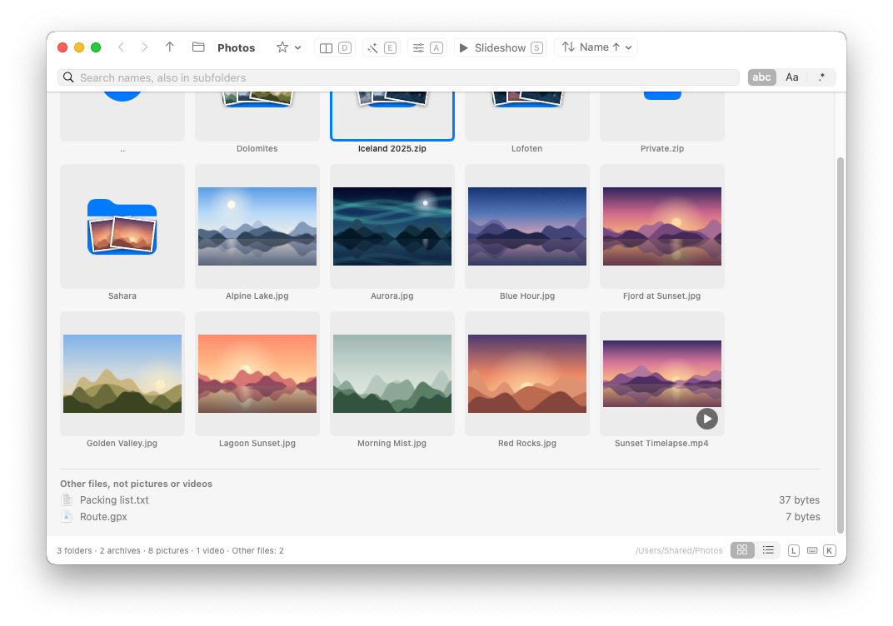
</picture></p>

<p align="center"><picture>
  <source media="(prefers-color-scheme: dark)" srcset="docs/screenshots/archive-inside-dark.webp">
  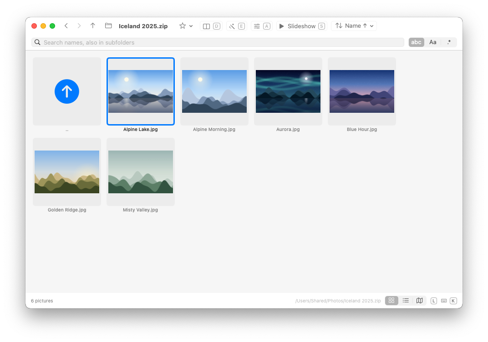
</picture></p>

<p align="center"><picture>
  <source media="(prefers-color-scheme: dark)" srcset="docs/screenshots/password-dark.webp">
  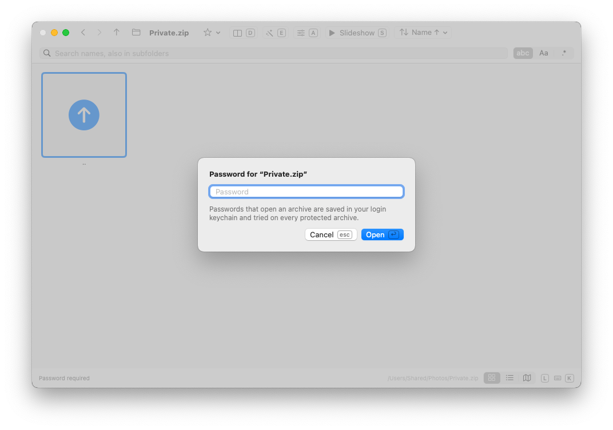
</picture></p>

### Boss key

<kbd>X</kbd> makes every window invisible and every video silent at once, and hides Schnellbild. The very first time, a note says how to come back. A click on the Dock icon or <kbd>⌘</kbd> + <kbd>Tab</kbd> brings Schnellbild to the front with every window still invisible; only <kbd>X</kbd> <kbd>X</kbd> <kbd>X</kbd> (three times within a second, with Schnellbild in front) shows them again, in full screen again if a window was. <kbd>⌘</kbd> + <kbd>Q</kbd> still quits while it is on. Given another key in Settings → Keyboard, that key three times brings the windows back.

| Key | Action |
|---|---|
| <kbd>X</kbd> | boss key on |
| <kbd>X</kbd> <kbd>X</kbd> <kbd>X</kbd> | boss key off (with Schnellbild in front: <kbd>⌘</kbd> + <kbd>Tab</kbd>) |

### All keys at hand

<p align="center"><picture>
  <source media="(prefers-color-scheme: dark)" srcset="docs/screenshots/help-dark.webp">
  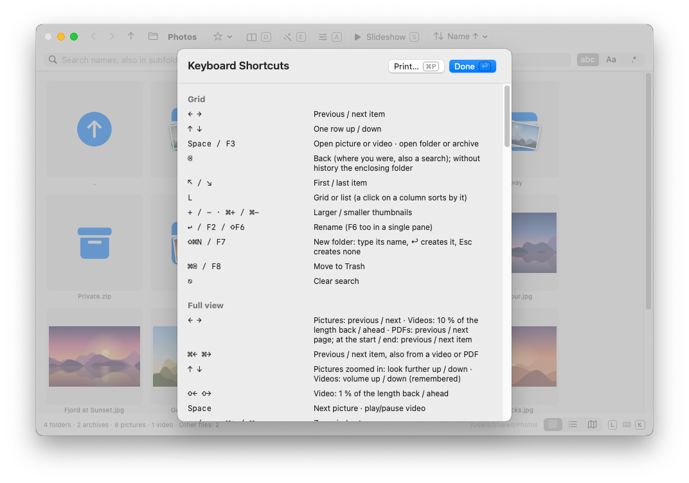
</picture></p>

<kbd>F1</kbd> (or <kbd>⌘</kbd> + <kbd>?</kbd>, or Help → Schnellbild Help) shows a cheat sheet of the keys, each key its own cap as on the keyboard; Print… (<kbd>⌘</kbd> + <kbd>P</kbd>) in it prints it on one page, or saves it as a PDF. <kbd>K</kbd> (or View → Mini Keyboard, or the keyboard switch in the status bar) slides up the **mini keyboard** under the window: the keys that work on what's on screen right now (the grid, the Atlas and its tour, a picture, a PDF, a video, the slideshow and its playlist), each with what it does. It is a cheat sheet you can click, handy with only a trackpad; a key you press on the real keyboard lights up on it, so you see what just happened. In a slideshow it shows while you move the mouse. The action buttons (Dual Pane, Auto Enhance, Adjust, Slideshow, Grid) show their key on the button; the others name it in their tooltip. <kbd>F9</kbd> opens the menus inside the window.

<p align="center"><picture>
  <source media="(prefers-color-scheme: dark)" srcset="docs/screenshots/keyboard-dark.webp">
  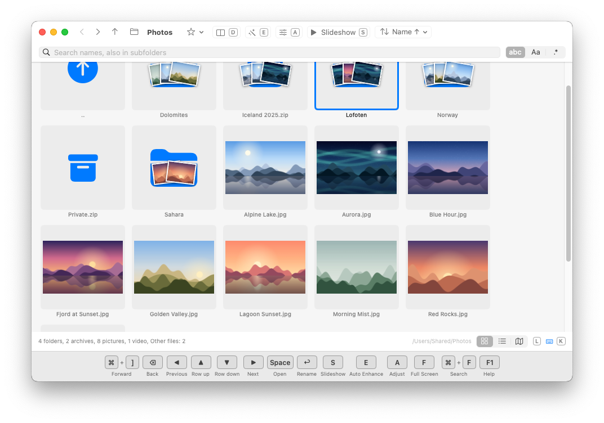
</picture></p>

### Your own keys

<p align="center"><picture>
  <source media="(prefers-color-scheme: dark)" srcset="docs/screenshots/shortcuts-dark.webp">
  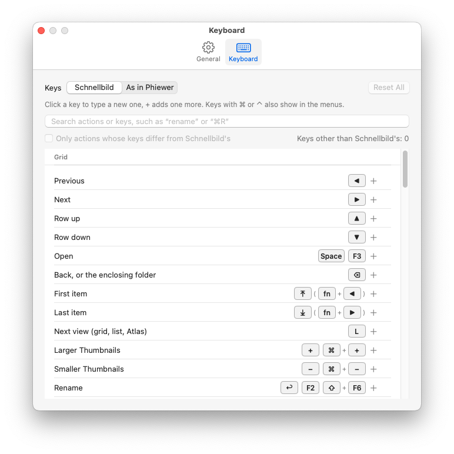
</picture></p>

Every action that has a key can get other keys, or more than one, in Settings → Keyboard (free, like everything else). The actions are grouped as in the cheat sheet, and the search field finds one by its name or its key (“rename”, “⌘R”, “cmd shift r”); click a key and type the new one, `+` adds another, a right-click removes one. A key another action already has moves over after asking, and that action loses it. Each action can go back to its preset's keys, or all at once.

Two presets give every action its keys: **Schnellbild** (the keys in these tables) and **As in Phiewer**, for people coming from Phiewer: <kbd>◀</kbd> / <kbd>▶</kbd> page through pictures and videos while <kbd>⌘</kbd> + <kbd>◀</kbd> / <kbd>⌘</kbd> + <kbd>▶</kbd> skip within a video, <kbd>⌫</kbd> moves to the Trash, <kbd>⌘</kbd> + <kbd>R</kbd> renames, <kbd>⌥</kbd> + <kbd>⌘</kbd> + <kbd>L</kbd> goes to the next view (grid, list, Atlas, as <kbd>L</kbd> does), <kbd>⌥</kbd> + <kbd>⌘</kbd> + <kbd>S</kbd> starts and ends the slideshow. Only what Schnellbild has gets Phiewer's key; everything else keeps Schnellbild's. The actions whose keys differ from Schnellbild's are marked and can be listed on their own.

The cheat sheet (also printed), the mini keyboard, the menus, the tooltips and the keys on the buttons always show the keys as set. Keys macOS keeps for itself (<kbd>⌘</kbd> + <kbd>Q</kbd>, <kbd>⌘</kbd> + <kbd>W</kbd>, <kbd>⌘</kbd> + <kbd>H</kbd>, <kbd>⌘</kbd> + <kbd>M</kbd>, <kbd>⌘</kbd> + <kbd>,</kbd>, <kbd>⌃</kbd> + <kbd>⌘</kbd> + <kbd>F</kbd> …) and those text fields need (<kbd>⌘</kbd> + <kbd>C</kbd>, <kbd>⌘</kbd> + <kbd>V</kbd>, <kbd>⌘</kbd> + <kbd>X</kbd>, <kbd>⌘</kbd> + <kbd>Z</kbd>) can't be given to an action. On a keyboard without Latin letters (Russian, Ukrainian …), the letter keys work as on your Latin layout.

### Settings

<p align="center"><picture>
  <source media="(prefers-color-scheme: dark)" srcset="docs/screenshots/settings-dark.webp">
  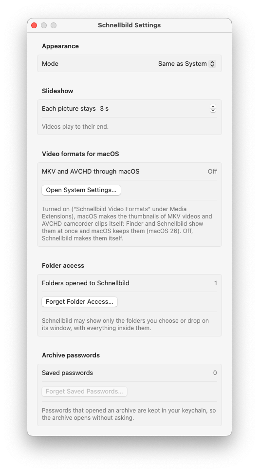
</picture></p>

Schnellbild → Settings (<kbd>⌘</kbd> + <kbd>,</kbd>) has two tabs. Keyboard holds [your own keys](#your-own-keys). General has six things: light or dark (as the system, or always light or always dark, whatever the system's setting), whether hidden files and folders show, how long a picture stays in the slideshow (1 to 60 seconds), whether macOS reads MKV and AVCHD itself (the media extension, with a button to System Settings), the folders you opened to Schnellbild (to forget them), and the archive passwords Schnellbild has saved, which you can forget all at once. Everything else it remembers by itself: the folder, the sort order, the view (grid, list or Atlas), the search mode, the dual pane and where its line lies, the mini keyboard, the volume, the subtitles and the languages chosen, the control bar's place, the bookmarks, the Atlas's "Include subfolders", the slideshow playlist's pin and width, the keys.

### Accessibility

- **VoiceOver** reads every tile and list row as one element ("name, kind", marked or not) with an Open action, every place on the Atlas's map, the timeline's handles (to move with VoiceOver), the path menu's actions and the video's control bar, which stays on screen while VoiceOver is on.
- **Reduce motion** (System Settings → Accessibility → Display): nothing glides or slides in, the map and the globe jump instead of flying, and the tour cuts from place to place.
- **Increase Contrast:** stronger tile backgrounds, marks and greyed-out folders.
- **Keyboard first:** the actions have keys, the keys work wherever the focus is, and the mini keyboard can be clicked instead.

### Supported file formats

**Pictures** (shown with macOS' own ImageIO, so a newer macOS can read more; what macOS doesn't read, Schnellbild decodes itself or with LibRaw):

| | Formats |
|---|---|
| Photos and graphics | JPEG (`.jpg`, `.jpeg`, `.jpe`), HEIC / HEIF (`.heic`, `.heif`, `.hif`, `.heics`, `.avci`), AVIF (`.avif`, `.avifs`), JPEG XL (`.jxl`), PNG and animated PNG (`.png`, `.apng`), GIF, WebP, TIFF (`.tif`, `.tiff`), BMP (`.bmp`, `.dib`), JPEG 2000 (`.jp2`, `.j2k`, `.j2c`, `.jpf`, `.jpx`), MPO |
| Vector and documents | SVG (`.svg`, `.svgz`), PDF (page by page, as vector pictures), Adobe Illustrator (`.ai`: as a PDF; saved without PDF content, its built-in thumbnail) |
| HDR and editing | OpenEXR (`.exr`), Radiance (`.hdr`), Photoshop (`.psd`, `.psb`), Targa (`.tga`), SGI (`.sgi`), Netpbm (`.pbm`, `.pgm`, `.ppm`, `.pnm`, `.pfm`), QuickDraw PICT (`.pict`, `.pct`), DICOM (`.dcm`, `.dicom`, macOS 26 and later), icons and cursors (`.ico`, `.icns`, `.cur`) |
| Textures | DDS, ASTC, KTX (`.ktx`, `.ktx2`), PVRTC (`.pvr`), ATX |
| Decoded by Schnellbild | QOI (`.qoi`), PCX (`.pcx`: 1 to 8 bits with a palette, 24 and 32 bits), DCX (`.dcx`: its first page) |
| By the picture they carry | EPS and PostScript (`.eps`, `.epsf`, `.epsi`, `.epi`, `.ps`: their TIFF, XMP or EPSI preview), Krita (`.kra`), OpenRaster (`.ora`), Procreate (`.procreate`), Sketch (`.sketch`) |
| Camera RAW (the models macOS knows) | Canon `.cr2` `.cr3` `.crw`, Nikon `.nef` `.nefx` `.nrw`, Sony `.arw` `.axr` `.sr2` `.srf`, Fujifilm `.raf`, Olympus / OM `.orf` `.ori` (`.ori` through LibRaw on macOS 15), Panasonic / Leica `.rw2` `.rwl` `.raw`, Pentax `.pef`, Samsung `.srw`, Hasselblad `.3fr` `.fff`, Phase One `.iiq`, Adobe `.dng`, Epson `.erf`, Kodak `.dcr`, Leaf `.mos`, Minolta `.mrw`, DxO `.dxo` |
| Camera RAW through LibRaw | Casio `.bay`, Phase One `.cap`, Kodak `.dcs` `.drf` `.k25` `.kdc`, Minolta `.mdc`, Mamiya `.mef`, Pentax `.ptx`, Logitech `.pxn`, Apple QuickTake `.qtk`, Sinar `.sti` |

Animated GIF, PNG and WebP play. RAW files show their built-in preview as a tile and are developed by macOS in the full view; the formats macOS doesn't read, a camera newer than your macOS and a RAW file macOS shows black or blown out are developed by LibRaw. PostScript is never run: macOS draws no PostScript since macOS 14, so an EPS or PS file shows the preview it carries, and one without a preview stays among the other files. The Inspector says "embedded preview" for such files.

**Videos:**

| | Formats | Plays through |
|---|---|---|
| What macOS plays | MP4, MOV (`.mov`, `.qt`), M4V, 3GP / 3G2 | AVKit |
| Everything else | MKV, WebM, AVI and DivX (`.avi`, `.divx`), WMV / ASF, FLV and F4V, Ogg video (`.ogv`, `.ogm`), MPEG (`.mpg`, `.mpeg`, `.m1v`, `.m2v`), DVD video (`.vob`), AVCHD (`.mts`, `.m2ts`), MPEG transport streams (`.ts`, `.m2t`), DV, RealMedia (`.rm`, `.rmvb`), MXF | VLC, built in |

The MP4 files of 360° cameras (Insta360 `.insv`, GoPro MAX `.360`) play as recorded, not stitched into a panorama. A `.ts` file counts as a video when its content is an MPEG transport stream (a TV or IPTV recording); TypeScript code, which uses the same ending, stays among the other files. Thumbnails in the Finder for these videos: see [Finder previews for more videos](#finder-previews-for-more-videos).

**Archives** (opened like folders, see [Archives as folders](#archives-as-folders)): ZIP and comic books (`.zip`, `.cbz`), RAR (`.rar`, `.cbr`, all versions, also in volumes `.part1.rar` … and `.rar` / `.r00` …), 7z (`.7z`, `.cb7`), and archives split by bytes (`.zip.001`, `.7z.001`) or as ZIP volumes (`.z01` …).

**Downloads still in progress** count as what they will be: `film.mp4.part` is an MP4, `photos.rar.part` a RAR, whichever tool is downloading them (Firefox, JDownloader and Transmission `.part`, `.partial`, Chrome `.crdownload`, Opera `.opdownload`, qBittorrent `.!qB`, µTorrent `.!ut` / `.!bt`, `.download`). A small arrow on the tile and in the list marks them. Pictures show as far as they have arrived, videos play as far as their data reaches (an MP4 that keeps its index at the end can only play once it is complete, and the full view says so), archives open with what is there; while the file grows, a video that stopped at the end of its data goes on and an archive shows what arrived. When the download finishes and the file gets its final name, the selection and a video playing go along.

**Files whose names say nothing** (no extension, or one no app knows, such as `IMG` or `video.xyz`) count by their content: Schnellbild reads their first bytes, in the background for a folder's files and at once for a file you open or drop, and shows the pictures, videos, PDFs and archives among them.

**Everything else** is listed by name and size under the grid; documents among it open with their app on a double click.

## Safe with files from others

Pictures, videos and archives from strangers are exactly what a viewer is for, so Schnellbild is built to treat every file as hostile, out of the box:

- **In Apple's App Sandbox.** The app and its extensions run in the App Sandbox, the same cage Apple puts every Mac App Store app in. So even a file made to attack a flaw in a decoder gets no further than Schnellbild itself may go: no network at all, no other programs started, and only the folders you open to it (by choosing them or dropping them on the window, plus your Pictures folder). Schnellbild remembers those folders, also those on a disk or server that isn't connected at the moment; a folder outside them asks first ("Allow Access…"; a single picture dropped from there shows at once, together with its XMP sidecar and the further volumes of an archive named like it, and its folder asks), and Settings → Folder access forgets them all. The Quick Look extension and the media extension run in processes of their own and read only the one file macOS hands them; media extensions are used only when you turned them on in System Settings.
- **Only reading.** Looking at something never changes it and never unpacks it to disk. Archives are read in memory; names inside them that try to climb out of the archive (`../`) are cleaned, and no read takes more than 256 MB.
- **Videos can't go online.** VLC gets exactly one reader per file, the video format its first bytes show (else the one its extension names), never a playlist or stream reader. So a "video" that is really a playlist pointing to the internet plays nothing, and no subtitle files are picked up from next to it. Options another program could plant in Schnellbild's preferences for VLC are removed at every start, and the VLC inside has no script engine. A QuickTime reference movie can't make macOS read other files or the network either.
- **PDFs are only drawn.** Their links, forms and scripts do nothing.
- **Metadata read with care.** The files beside a photo (sidecars, GPX tracks, flight logs) are read only when they are plain files of a sensible size, and their XML may not pull in anything else.
- **Double click opens documents, not programs.** "Open with Default App" opens only pictures, videos, PDFs, folders and archives of the formats Schnellbild reads (ZIP, RAR, 7z), never installer packages or disk images. Other files open only from an allow list of document types (text, PDF, office, audio …); apps, scripts, installers, disk images, Terminal settings and web content that would run in a browser (HTML, web archives, SVG) never. Links and aliases are followed first and must lead to a file of their own extension, so a picture's or an archive's name can't hide one of them. A `.webloc` opens only an `http(s)` address.
- **A signed, closed app.** Signed with a Developer ID and notarized by Apple, with the Hardened Runtime: only Apple's code and Schnellbild's own libraries can load into it. It registers no URL schemes or document types that a web page or another app could use to make it open something.
- **Nothing goes online.** No map service, no geocoder, no update check: the map and the place names are inside the app. Your Mac's position is asked for only when you click Use My Location, and it stays in the app.
- **No crash loops.** If a file ever made Schnellbild quit, it doesn't reopen that folder at the next start.

The limit: the decoders run in the app's process (VLC with FFmpeg for videos, UnRAR and macOS' libarchive for archives, macOS' ImageIO for pictures). A flaw in one of them could in principle run code inside Schnellbild; the sandbox then keeps that code to what Schnellbild may do itself: the folders you opened to it, without network. That's why VLCKit and UnRAR are kept at their latest security releases.

## Provably built from this source

Every DMG is built on GitHub's own Macs by this repository's [release workflow](.github/workflows/release.yml), from a tagged commit you can read, and GitHub signs a build attestation for it (SLSA Build Level 2, signed with [Sigstore](https://www.sigstore.dev) and recorded in a public transparency log). It ties the file's SHA-256 to the repository, the commit and the workflow run that made it. Nobody, the author included, can make one for a file that this workflow didn't build. So what you download is what the source here says, and nothing was slipped in on someone's own computer.

Check the DMG you downloaded, with the [GitHub CLI](https://cli.github.com) (`brew install gh`, then `gh auth login`):

```sh
gh attestation verify ~/Downloads/Schnellbild.dmg --repo JohannesHoppe/schnellbild
```

Or the app you installed (its program file keeps its fingerprint from the DMG into Applications):

```sh
gh attestation verify /Applications/Schnellbild.app/Contents/MacOS/Schnellbild --repo JohannesHoppe/schnellbild
```

"Verification succeeded!" means the file is exactly what GitHub's build produced; the output names the commit (`sourceRepositoryDigest`) and the workflow run (`runInvocationURI`) it came from, which you can open on GitHub. Anything else, and the file isn't from here. Without the CLI: all attestations are listed at [github.com/JohannesHoppe/schnellbild/attestations](https://github.com/JohannesHoppe/schnellbild/attestations), each with the SHA-256 it covers; compare it with `shasum -a 256 ~/Downloads/Schnellbild.dmg`.

The DMG is attested twice: as built (the release workflow) and after Apple's notarization ticket is stapled to it ([Finish Mac release](.github/workflows/mac-release.yml), which takes exactly that build and only adds the ticket); the app inside is the same in both. From version 0.11.0 on.

The Mac App Store version can't be checked this way: Apple signs every Store app anew before it delivers it, which changes the file. It is built by the same scripts from the same commit ([App Store workflow](.github/workflows/appstore.yml)), with the same version and build number as the DMG of that release.

## A free Phiewer alternative

Three programs were the models for Schnellbild: Phiewer for browsing pictures by keyboard, IINA for handling videos quickly, and Norton Commander for the [dual pane](#dual-pane-sort-your-holiday-photos) with its F-keys.

[Phiewer](https://phiewer.com/) is a fast photo viewer for the Mac, free as Phiewer (lite) and bought once as Phiewer PRO, and the model for Schnellbild's keyboard-first browsing. Phiewer edits photos, finds duplicates, gathers albums across folders and searches by tags and EXIF, all of which Schnellbild leaves out. Schnellbild is for people who want the pictures and videos in their folders in one free app with every feature in, archives and MKV included; its keys can be set as in Phiewer. Phiewer's side is what [phiewer.com](https://phiewer.com/) and its App Store pages ([PRO](https://apps.apple.com/app/id1270923434), [lite](https://apps.apple.com/app/id1226444549)) list (as of November 2026) and what we found using it; "not listed" means they don't mention it.

| | Schnellbild | Phiewer |
|---|---|---|
| Price | free, open source (MIT), no pro version | lite free; PRO a one-time purchase |
| macOS | 15 and later | 15 and later |
| Grid, full view, slideshow through subfolders | yes | yes (subfolders in PRO) |
| Search | names of folders and files, all subfolders | in PRO: name, tags, comments, date, EXIF |
| ZIP, RAR and 7z archives as folders (also with passwords) | yes | no |
| MKV, WebM and other formats macOS can't play | yes (built-in VLC engine) | not listed (MP4, MOV, AVI, MPG, 3GP, MTS, TS …) |
| Two panes side by side, Norton Commander keys | yes | no |
| Auto enhance and sliders for photos and videos | yes, as a view: files are never changed | in PRO: edits with filters, effects and undo; crop, rotate, flip |
| Duplicates, albums across folders (Showcases) | no | in PRO |
| Audio files, Finder tags, export, printing pictures | no | yes (tags, export and printing in PRO) |
| Your own keyboard shortcuts | yes, free, with Phiewer's keys as a preset | in PRO |

## A free IINA alternative for looking through videos

[IINA](https://iina.io/) is a free and open-source media player for the Mac, and the model for how Schnellbild handles videos: several keys are the same (<kbd>Space</kbd> plays and pauses, <kbd>◀</kbd> / <kbd>▶</kbd> skip, <kbd>▲</kbd> / <kbd>▼</kbd> set the volume, <kbd>⌘</kbd> + <kbd>◀</kbd> / <kbd>⌘</kbd> + <kbd>▶</kbd> go to the previous or next file, <kbd>V</kbd> switches subtitles). IINA is made for watching, with subtitle files, chapters, Picture in Picture, a music mode and plugins. Schnellbild is for people who keep photos and videos together in folders and want to browse, sort and play them in one app. IINA's side is what its [website](https://iina.io/), its [README](https://github.com/iina/iina#features) and its default key bindings list (as of November 2026); "not listed" means they don't mention it.

| | Schnellbild | IINA |
|---|---|---|
| Price | free, open source (MIT) | free, open source (GPL 3) |
| macOS | 15 and later, Apple silicon | 12 and later (11 on Intel) |
| Engine | AVKit, VLC for what macOS can't play | mpv |
| Photos and videos in one grid, folders, search | yes | not listed (playlists, playback history) |
| Videos inside ZIP, RAR and 7z archives | yes, streamed without unpacking | not listed |
| <kbd>◀</kbd> / <kbd>▶</kbd> | a tenth of the video, with <kbd>⇧</kbd> a hundredth, then on to the next file | 5 seconds |
| Slideshow through photos and videos | yes | not listed |
| Two panes side by side to sort into folders | yes | no |
| Auto enhance and sliders for videos | yes | video and audio filters |
| Codec, bitrate, wrong file extensions in the file info | yes | not listed |
| Subtitles inside the video, audio tracks, speed | yes | yes |
| Subtitle files, chapters, online subtitle search | no | yes |
| Picture in Picture, frame by frame | no | yes |
| Audio files (music mode) | no | yes |
| Your own keyboard shortcuts | yes | yes |
| Plugins | no | yes |

## Why so fast?

1. **Riding on the system.** Thumbnails come from Apple's Quick Look (`QLThumbnailGenerator`). It pulls **embedded previews** (EXIF thumbnail, JPEG in RAW): a few KB instead of tens of MB over the network. Quick Look keeps the thumbnails in the system's own cache on your Mac, for folders on network shares too. For many videos Quick Look can't read itself (MKV, WMV, FLV, VOB …), Schnellbild brings a Quick Look extension: VLC takes a frame, macOS keeps it like any other thumbnail, so such a video is read once, not on every visit (see [Finder previews for more videos](#finder-previews-for-more-videos)). Schnellbild also keeps the thumbnails of the session in memory (up to an eighth of the Mac's memory), so scrolling back through thousands of search results asks no one again.
2. **Lazy and parallel.** The grid only loads the tiles on screen, and the system runs thumbnail generation in parallel.
3. **Full view downsampled.** The full picture is read through ImageIO and sampled straight to screen size, no 8000 px monster in memory. The thumbnail shows instantly as a placeholder.
4. **Nothing blocks the main thread.** Reading folders, searching, sorting tens of thousands of items and decoding run in the background.

## Building

Building from source, tests and releases: [BUILDING.md](BUILDING.md).

## License

[MIT](LICENSE) © 2026 HAUS HOPPE - ITS (Johannes Hoppe)

The MIT License covers Schnellbild's own code. The app also contains VLCKit (an LGPL-only build under the GNU LGPL 2.1 or later, made by us without any code under the GPL: none of VLC's GPL modules and none of the GPL parts of the libraries inside it, FFmpeg and the others, each under its own license), UnRAR (UnRAR license), LibRaw (CDDL 1.0; LibRaw offers it or the LGPL 2.1), the map data and the globe data below; each keeps its own license. The app's About window (Schnellbild → About Schnellbild) shows every one of these license texts in full, Schnellbild's MIT License first. Details and the source of VLCKit: [THIRD-PARTY-NOTICES.md](THIRD-PARTY-NOTICES.md).

The offline map's data is © [OpenStreetMap](https://www.openstreetmap.org/copyright) contributors, under the Open Database License (ODbL) 1.0. The map files are made from [Protomaps](https://protomaps.com)' OpenStreetMap build, with thanks to Protomaps; how they are made: `Scripts/build_map_data.py`. Country codes for places: [Natural Earth](https://www.naturalearthdata.com) (public domain). The globe's relief comes from NOAA's [ETOPO 2022](https://doi.org/10.25921/fd45-gt74) (public domain, not to be used for navigation), its night sky from [Deep Star Maps 2020](https://svs.gsfc.nasa.gov/4851) by NASA/Goddard Space Flight Center Scientific Visualization Studio (from Gaia DR2, Hipparcos and Tycho-2 data) and the lights of its night side from [Black Marble 2016](https://science.nasa.gov/earth/earth-observatory/earth-at-night/maps/) (NASA Earth Observatory images by Joshua Stevens, using Suomi NPP VIIRS data from Miguel Román, NASA GSFC), the colours of its ground from [Blue Marble: Next Generation](https://science.nasa.gov/earth/earth-observatory/blue-marble-next-generation/) (NASA Earth Observatory, produced by Reto Stöckli) and its clouds from [The Blue Marble](https://science.nasa.gov/earth/earth-observatory/the-blue-marble-true-color-global-imagery-at-1km-resolution/) (NASA Goddard Space Flight Center, image by Reto Stöckli); how the files are made: `Scripts/build_globe_data.py`.
