

  

<h1 align="center">Schnellbild</h1>

  

<b>An image &amp; video viewer for macOS that just doesn't suck.</b>

<!-- Demo: record per docs/launch-storyboard.md, save as docs/demo.gif, then
     uncomment the next line:

-->

<picture>
  <source media="(prefers-color-scheme: dark)" srcset="docs/screenshots/grid-dark.png">
  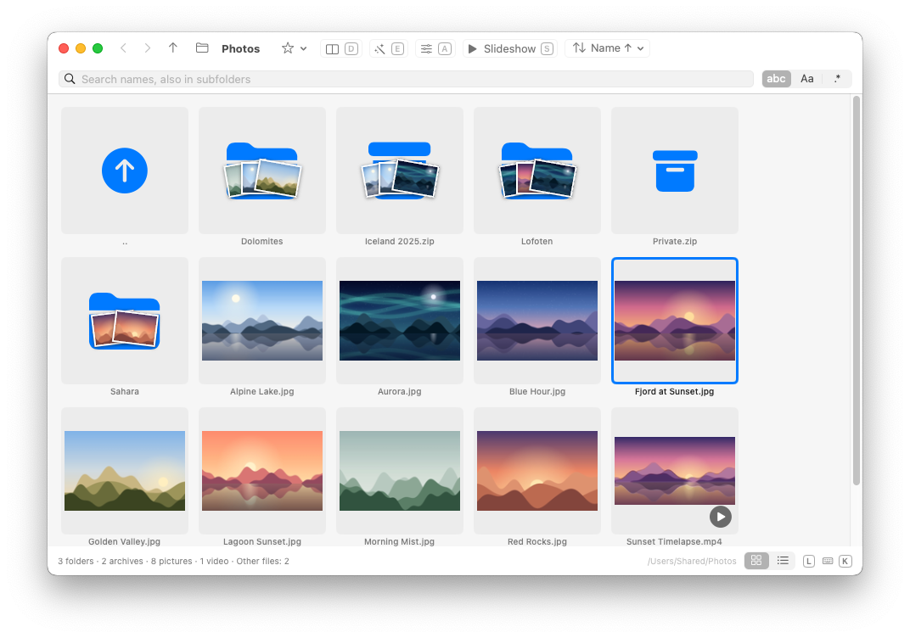
</picture>

Open a folder, see thumbnails, look at one picture large, page through with the keyboard. Videos play right there, too, even AVI, MKV and WebM. No library to import into, no waiting, no clutter: it opens what you point it at, stays quick on big folders and network shares alike, and gets out of your way.

## Why it doesn't suck

- **No ads, no tracking, no account.** It shows your pictures and talks to nobody.
- **No upselling.** No pro version, no subscription, no "unlock" button. Every feature is in.
- **No bloat.** No library to import into, no editor, no cloud. Just looking at photos and videos, done well.
- **Fast.** Thumbnails appear while you scroll, big folders and network shares included (see [Why so fast?](#why-so-fast)).
- **Careful with files from others.** Looking never runs anything: archives are only read, never unpacked to disk; videos are read only as local files (a "video" can't make it go online); "Open with Default App" opens only real pictures, videos, PDFs, archives and folders, never an app hiding behind a picture's name; and if a file ever made Schnellbild quit, it doesn't reopen that folder at the next start.
- **Doesn't fall over.** Broken files, odd formats and slow disks show a placeholder instead of taking the app down. Your files are only changed when you say so: rename, trash, a new folder, or moving and copying them (dragging tiles onto a folder, F5 / F6 in the dual pane).

## Download

**[Schnellbild.dmg](https://github.com/JohannesHoppe/schnellbild/releases/latest/download/Schnellbild.dmg)** (macOS 15+, Apple silicon only: Macs with an Intel processor aren't supported): open it and drag Schnellbild into Applications. Signed with a Developer ID and notarized by Apple.

Schnellbild follows your Mac's language: English, Deutsch, Français, Español, Italiano, Português (Brasil), Nederlands, Polski, Svenska, Dansk, Norsk, Suomi, Čeština, Türkçe, Русский, Українська, 日本語, 한국어, 简体中文 and 繁體中文.

## Features

### Browse folders

Open a folder with ⌘O or drag it onto the window; drag a single file to open it straight in the full view. Subfolders come first, each previewing its first pictures or videos like Finder (from its subfolders when it holds none itself), with a `..` tile to go up. Folders without a single photo or video anywhere inside are greyed out, so you don't bother opening them (a `Thumbs.db` or `desktop.ini` doesn't count). `L` shows it as a [list](#list-view) instead. Files that aren't pictures, videos or archives are listed by name and size under the grid (in the list as grey rows), so a folder that holds only such files never looks empty; "This folder is empty" means it holds nothing at all; a folder Schnellbild can't read (no permission, a share that went away) says "This folder can't be read" with the reason, never "empty". Thumbnails come from QuickLook: JPEG, HEIC, AVIF, JPEG XL, PNG, GIF, WebP, TIFF, SVG, PDF, PSD, OpenEXR, the camera RAW formats macOS reads, and a poster frame for videos. A symbolic link shows as what it points to (a link to a folder on a share opens like that folder); walks through subfolders don't follow links. Schnellbild reopens the last folder on launch.

| Key | Action |
|---|---|
| ← → | previous / next item |
| ↑ ↓ | one row up / down |
| Space | open the picture or video, or enter the folder |
| Backspace | back to where you were, also to a search and its results (with no history yet: up a level) |
| ⌘↑ / `..` | up one folder level; above `/` lie all drives, the Mac's own disks, external ones and network shares |
| Home / End | first / last item |
| + / − (or ⌘+ / ⌘−) | larger / smaller thumbnails |
| ⌘[ / ⌘] | back / forward, restoring the folder, the search and the selection |
| f / ⌃⌘F | full screen |
| Return / F2 | rename the selected folder or file, as in the Finder (Return on `..`: up a level) |
| L | grid or list (a click on a column header sorts by it) |
| D / ⌃O | dual pane on / off |
| K | mini keyboard on / off |
| ⌘D | bookmark the folder shown, or remove its bookmark (also the star in the toolbar, the Bookmarks menu and a folder's right-click menu) |
| ⌃1 … ⌃9 | open bookmark 1 … 9 |
| X | boss key: every window turns invisible and every video silent at once; only X X X, typed with Schnellbild in front (Dock or ⌘-Tab, which show no window meanwhile), brings them back |
| ⌘A / Esc | mark all / unmark; Esc with nothing marked clears the search |

### List view

<picture>
  <source media="(prefers-color-scheme: dark)" srcset="docs/screenshots/list-dark.png">
  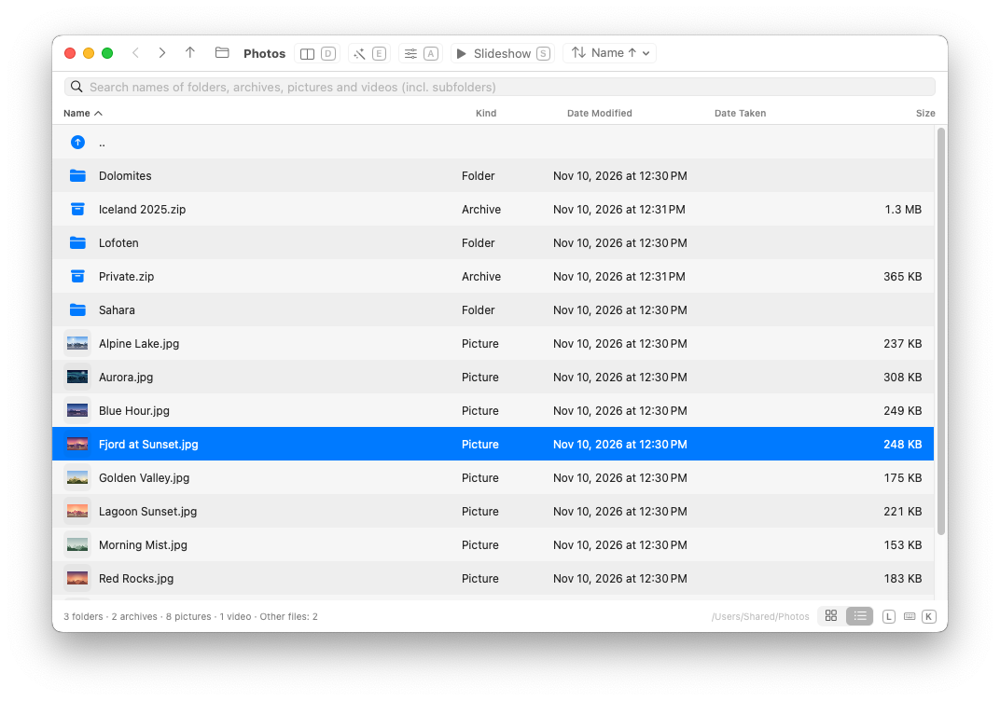
</picture>

`L` (or the switch in the status bar) shows the folder as a list: a small preview (for a folder, its first pictures fanned out as on its tile), the whole name, kind, date modified, date taken and size in columns. A click on a column's header sorts by it, another reverses it, the same sort as the sort menu. Everything else works as in the grid: clicking, marking, dragging, opening. Each half of the dual pane keeps its own choice, and Schnellbild remembers it.

### Sort

<picture>
  <source media="(prefers-color-scheme: dark)" srcset="docs/screenshots/sort-dark.png">
  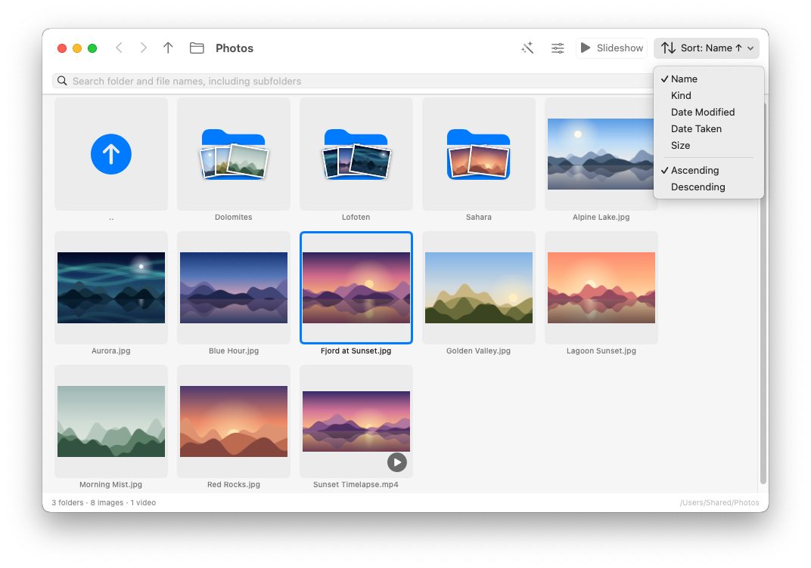
</picture>

By name, kind, date modified, date taken or size, from the toolbar or with one key. The same key again reverses the order. Date taken reads the camera's capture date (EXIF, or the video's creation date), so copied photos still line up in the order they were shot. Dates and sizes start newest and largest first, like Finder. Schnellbild remembers the order.

| Key | Action |
|---|---|
| ⌘1 … ⌘5 | sort by name, kind, date modified, date taken, size (again: reverse) |

### Search, including subfolders

<picture>
  <source media="(prefers-color-scheme: dark)" srcset="docs/screenshots/search-dark.png">
  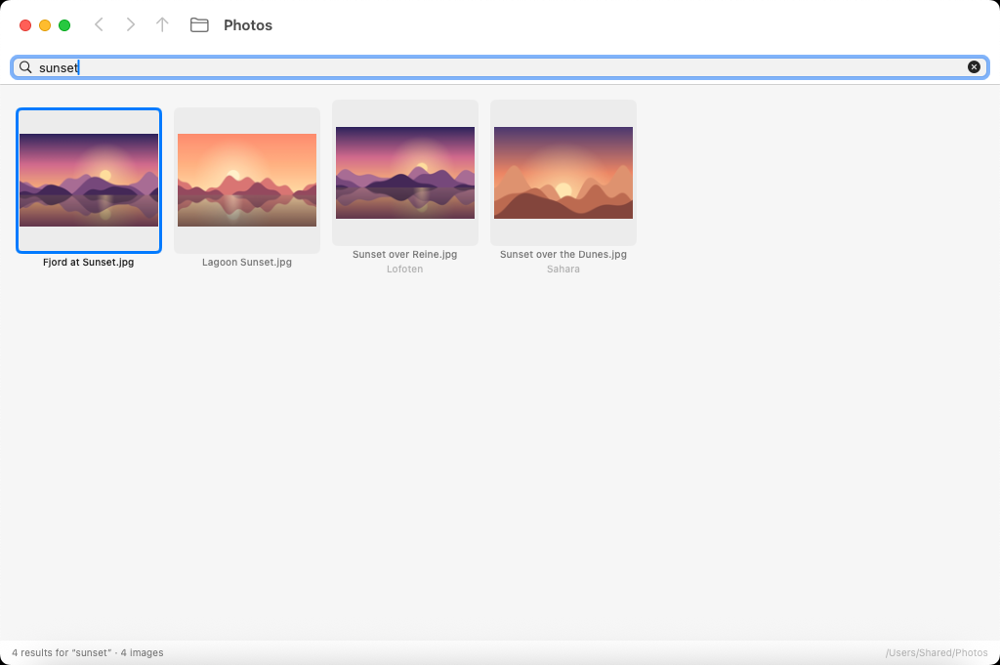
</picture>

The search field is always there. It matches the names of folders, archives, pictures and videos in the current folder and everything below it (inside an archive when you search there; a search doesn't open the archives it passes); results stream in while the tree is walked and show where they live. The stop button next to the spinner ends a long search over a slow network share and keeps what it has found. Back from an opened result returns to the same results without searching again; a search that was still running when you opened a result goes on in the background meanwhile. The switch beside the field sets how names match: `abc` ignores case, `Aa` matches the case as typed, `.*` takes a regular expression (found anywhere in the name; `^`, `$` and `(?i)` work as usual). Each half of the dual pane remembers its choice.

| Key | Action |
|---|---|
| ⌘F | focus the search field |
| ↓ | move into the results |
| Return | open the selected result |
| Esc | clear the search; once more: leave the field |

### Full view

<picture>
  <source media="(prefers-color-scheme: dark)" srcset="docs/screenshots/full-dark.png">
  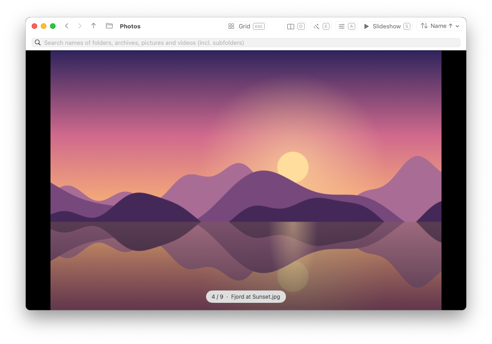
</picture>

One picture, as large as the window allows, with its position in the folder. The full image is sampled to screen size, the thumbnail shows instantly until it's there. Animated GIFs play, and zoom, turn and take the enhance filter like any photo.

| Key | Action |
|---|---|
| ← → | previous / next picture (on a video: see below) |
| ⌘← ⌘→ | previous / next item, also from a video |
| ↑ ↓ | pictures zoomed in: look further up / down; videos: volume up / down |
| Space | next picture |
| Esc / Backspace / Return | back to the grid, at the same place |

### Slideshow

<picture>
  <source media="(prefers-color-scheme: dark)" srcset="docs/screenshots/slideshow-dark.png">
  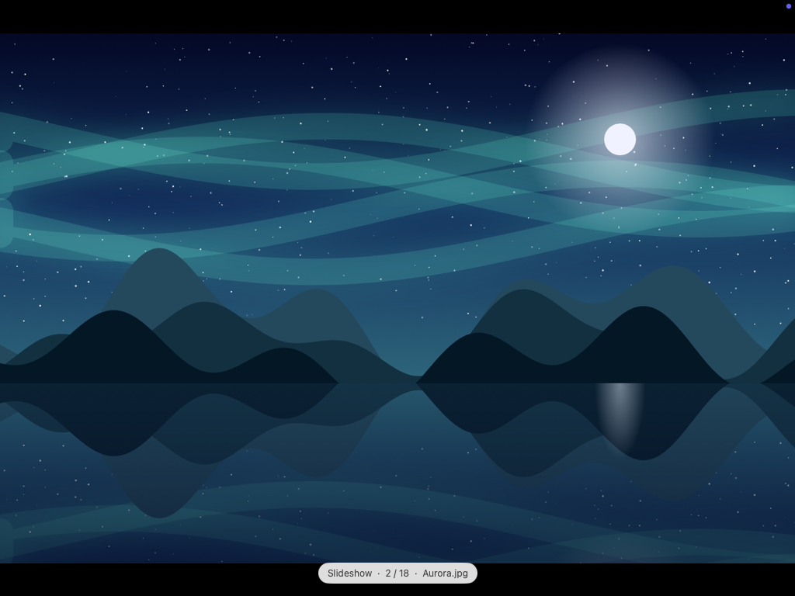
</picture>

Schnellbild has two ways of looking at a folder: **browse** it in the grid, or sit back and watch a **slideshow** of everything in it. The slideshow plays every photo and video in the folder **and all its subfolders**, in full screen, folder by folder in the sort order you chose. The sort order applies within each folder and to the order of the subfolders: sorted by name, folders like `Day 1`, `Day 2` … play one after the other; sorted by date taken, the pictures in each folder play in the order they were shot. Pictures stay three seconds (Settings, ⌘, sets 1 to 60), videos play to their end, then it moves on. It starts at once, while the subfolders are still being read; until then the count at the top says "so far" ("3 / 57 so far").

Three ways to start it:

- **▶︎ Slideshow** in the toolbar, or the `s` key: plays the folder you're in, with everything below it. While you search, it plays the search results instead.
- **Right-click a folder tile → Start Slideshow of This Folder:** plays just that folder (and its subfolders), without opening it first.
- **Drag a folder onto the window:** the window splits into two halves. Drop it on **Browse** to look around in the grid, or on **Slideshow** to start the show straight away. A single dropped picture starts the slideshow of its folder at that picture.

It starts where you are: from the full view at the picture you're looking at; in the grid at the file you selected, or at the first picture inside the folder you selected (also deep in the subfolders), and goes on from there, round to the start at the end. `Esc` ends it and brings you back to where you were.

| Key | Action |
|---|---|
| s | start the slideshow (again: end it) |
| Space | pause / resume |
| ← → | previous / next picture; in a video 10 % of its length back / ahead |
| ⇧← ⇧→ | in a video 1 % of its length back / ahead |
| ⌘← ⌘→ | previous / next item |
| ↑ ↓ | pictures zoomed in: look further up / down; videos: volume up / down |
| f / i / e / a | full screen, file info, auto enhance, sliders, as in the full view |
| Esc / Return / Backspace | end the slideshow |

### Zoom and rotate

<picture>
  <source media="(prefers-color-scheme: dark)" srcset="docs/screenshots/zoom-dark.png">
  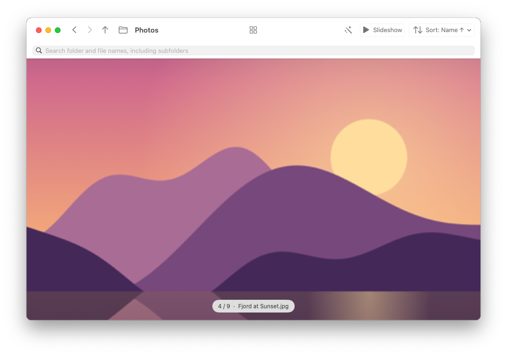
</picture>

Zoom with the keyboard or a trackpad pinch, drag to pan, rotate in steps of 90°, for photos and videos alike, also in the slideshow. Only the view changes; Schnellbild never modifies your files.

| Key | Action |
|---|---|
| + / − (or ⌘+ / ⌘−) | zoom in / out |
| 0 / 1 | fit to window / a photo's real size (100 %; a photo smaller than the window stays fitted, a video always) |
| ⌥← / ⌥→ | rotate left / right |

### Videos

<picture>
  <source media="(prefers-color-scheme: dark)" srcset="docs/screenshots/video-dark.png">
  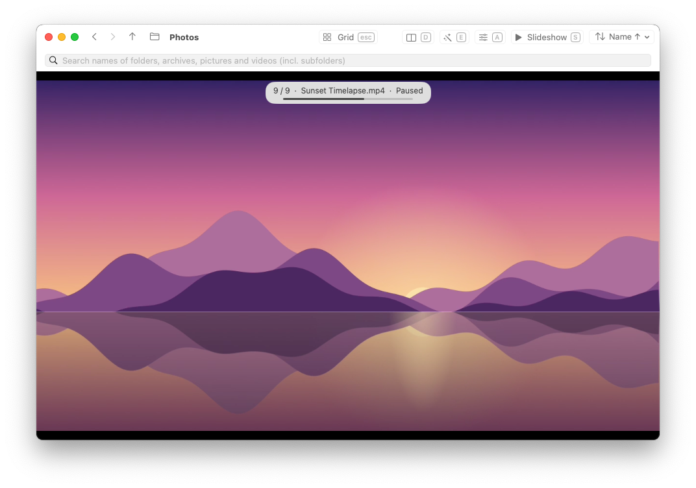
</picture>

Videos play right away, MP4 and MOV through AVKit, formats macOS can't play (AVI, MKV, WebM, DVD's VOB …) through the built-in VLC engine. Media Extensions turned on in System Settings → General → Login Items & Extensions (Apple's own, or another app's for more formats) are used too: such videos play in AVKit, and on macOS 26 their thumbnails come from them. The arrow keys skim: each press jumps a tenth of the video ahead or back, past the end on to the next item, with ⇧ a hundredth. So one key pages through photos and skims through videos; ⌘← ⌘→ skip a video at once. A thin bar under the name at the top shows how far the video has played, the time left beside it. While a video is turned, the player's own control bar is hidden (it would turn with the picture); the keys work as always. ↑ ↓ set the volume of every video, shown a moment while it changes, and kept for the next launch.

| Key | Action |
|---|---|
| Space | play / pause |
| ← → | 10 % of the length back / ahead; at the end on to the next item, at the start back to the previous one |
| ⌘← ⌘→ | previous / next item straight away |
| ↑ ↓ | volume up / down in tenths, for every video, remembered (shown while it changes) |
| ⇧← ⇧→ | 1 % of the length back / ahead, to find a place exactly |

<picture>
  <source media="(prefers-color-scheme: dark)" srcset="docs/screenshots/volume-dark.png">
  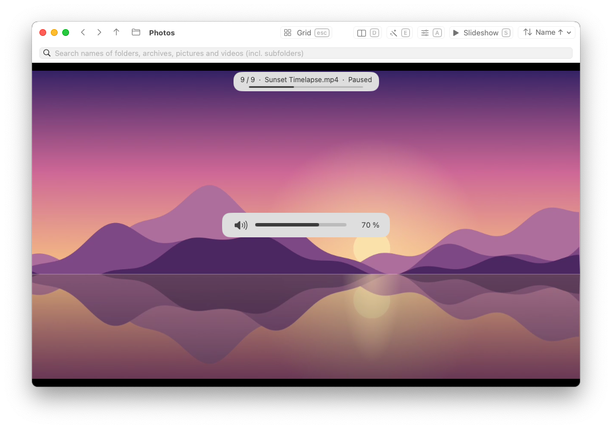
</picture>

### Finder previews for more videos

macOS shows many video formats as plain icons, in the Finder too. Schnellbild teaches macOS some of them: it brings a QuickLook extension that takes a frame from such a video. The Finder and Schnellbild's grid then show a picture, and macOS keeps it in its own thumbnail cache, so a video on a network share is read once, not on every visit.

- Formats: MKV, WebM, WMV, ASF, FLV, Ogg video and DVD video (`.vob`). What macOS reads itself (MP4, MOV, MPEG, …) stays with macOS.
- AVI and AVCHD camcorder clips (`.mts`, `.m2ts`) stay icons in the Finder: macOS hands these formats to its own extension, not to Schnellbild's. Schnellbild's grid still shows a picture for them.
- Works whether Schnellbild is open or not: macOS starts the extension when a picture is needed and ends it afterwards. It is known to macOS once Schnellbild has been opened, and goes away with the app.
- Runs in Apple's App Sandbox: no network, and it may read only the one file macOS hands it.
- Can be switched off in System Settings → General → Login Items & Extensions → Quick Look. Schnellbild then draws these tiles itself, for as long as it runs.

Schnellbild also brings a **media extension**, "Schnellbild Video Formats": it teaches macOS itself to read MKV videos (H.264 and HEVC). Turned on, the Finder and Schnellbild get their thumbnails straight from macOS on macOS 26, the fastest way and kept by macOS, and QuickTime Player and the space-bar preview play them. It is off until you turn it on under System Settings → General → Login Items & Extensions → Media Extensions; Schnellbild → Settings shows whether it is on and opens that page. Like the Quick Look extension it runs in the App Sandbox and reads only the file macOS hands it. Off, or on macOS 15, everything works as described above.

### Auto enhance and adjustments

Night shots and dark videos, or washed-out, overexposed ones: press `e` (or the wand in the toolbar) and Schnellbild sets four values for the picture on screen:

- **Exposure:** brightens dark material and tones down overexposed material.
- **Contrast:** stretches flat, hazy pictures.
- **Saturation:** lifts washed-out colours and calms garish ones.
- **Sharpness:** crisper edges, like an unsharp mask.

<picture>
  <source media="(prefers-color-scheme: dark)" srcset="docs/screenshots/adjust-dark.png">
  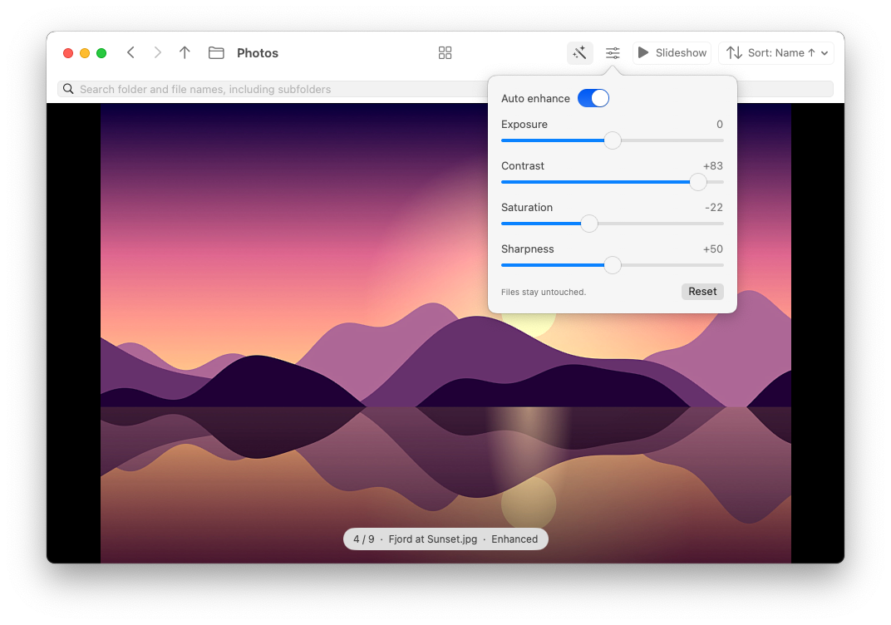
</picture>

Press `a` (or the sliders button next to the wand) to see these values. With auto enhance on, the sliders show what it sets for each photo, and for videos they move with the scenes. Videos are measured once a second, and the values glide instead of jumping, so a dark intro or a cut doesn't throw them and nothing flickers. After you skip, they're measured again at once.

When auto gets a picture wrong, move a slider. Auto enhance switches off and you carry on from its values. Your settings stay while you page on, until you reset them or switch auto enhance on again. Switching it off shows the files as they are.

It's a filter on the screen only: your files stay exactly as they are. Photos and videos of every format go through the same filter, so the sliders work the same everywhere, at once.

| Key | Action |
|---|---|
| e | auto enhance on / off |
| a | show / hide the sliders (Esc hides them too) |

### File info

<picture>
  <source media="(prefers-color-scheme: dark)" srcset="docs/screenshots/inspector-dark.png">
  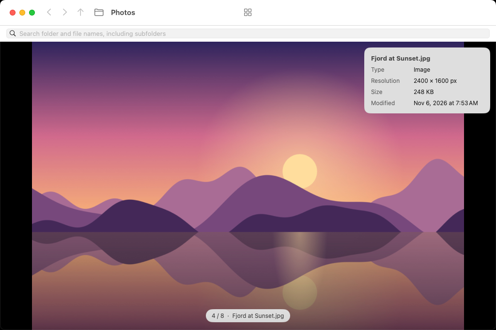
</picture>

Name, type, resolution, size, when it was taken (from the photo's EXIF or the video's creation date) and when it was last changed, for the item on screen.

| Key | Action |
|---|---|
| i | show / hide the file info |

### Rename, reveal, trash, sort into folders

<picture>
  <source media="(prefers-color-scheme: dark)" srcset="docs/screenshots/rename-dark.png">
  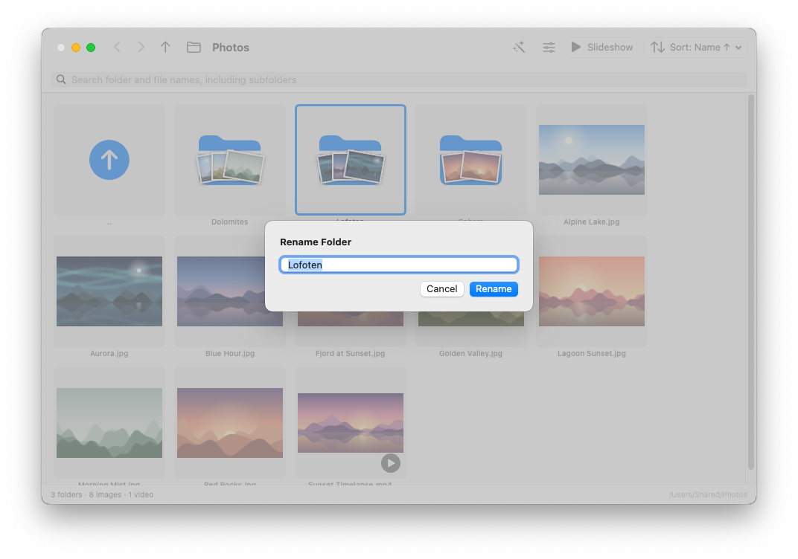
</picture>

Rename a folder or file in place: Return (as in the Finder) or F2 in the grid, F2 also in the full view, the Actions menu, or right-click. The folder you are in is renamed by clicking its name in the title bar. For files the name without its extension is selected, like in Finder. The search results and the history follow the new name. Reveal an item in Finder, open it in its default app, or move it to the Trash after a confirmation. To sort pictures into folders: ⇧⌘N makes a folder (it exists only once you have named it and pressed ↩), then drag tiles onto a folder tile, or onto `..` to move them up a level. On the same volume they are moved, onto another one copied, as in the Finder. Tiles can be dragged to the Finder too. The other files listed under the grid (anything that isn't a picture, video or archive) are renamed, revealed and trashed by right-click, and dragged onto a folder like a tile. A double click (or Open in that menu) opens a document with its app: text, PDFs, office documents, sound and the like; a web location (.webloc, .url) opens its web address in the browser. Apps, scripts, installers, disk images and anything else that runs a program are never opened from Schnellbild, nor a web location that points anywhere but to a web page. Inside archives nothing is changed. Renaming, trashing, moving and copying can be undone and redone as often as you like: the top of the right-click menu says what ("Undo Move to Trash", "Redo Rename"), on purpose without a key, so no stray ⌘Z moves files around. A trashed item comes back out of the Trash to where it was; an undone copy goes to the Trash.

| Key | Action |
|---|---|
| F2 | rename the selected folder or file, also in the full view |
| ⇧⌘N | new folder: type its name, ↩ creates it, Esc creates none |
| ⇧⌘R | reveal in Finder |
| ⌘↩ | open with the default app |
| ⌘⌫ | move to Trash |

<picture>
  <source media="(prefers-color-scheme: dark)" srcset="docs/screenshots/newfolder-dark.png">
  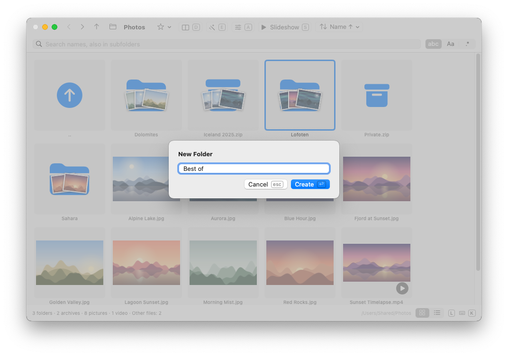
</picture>

### Dual pane: sort your holiday photos

<picture>
  <source media="(prefers-color-scheme: dark)" srcset="docs/screenshots/dualpane-dark.png">
  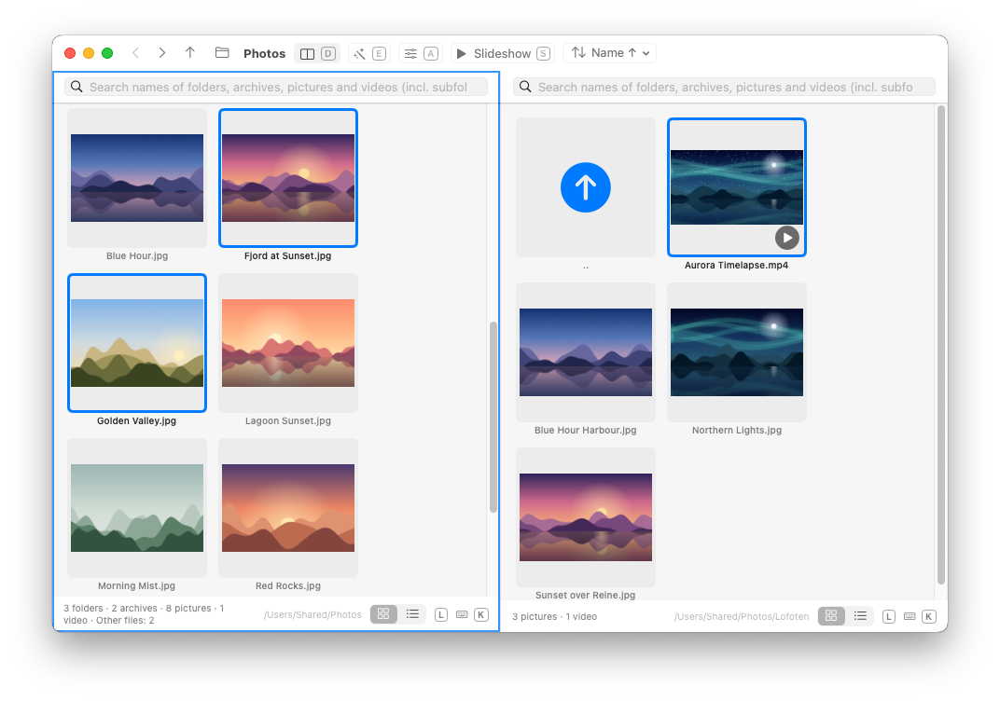
</picture>

**Dual Pane** in the toolbar (or `D`) splits the window in two, like the classic two-panel file managers. Each half is a browser of its own: its own folder, search, history and sort order; the one outlined in color is the one the keys work on, `Tab` switches. A picture or video opens large in its own half. A folder's right-click menu opens it in the other half ("Open in Other Pane"). Mark several items with ⌘-click, ⇧-click or ⇧-arrows (⌘A all, Esc none), then press `F5` to copy or `F6` to move them into the other half's folder, or drag them over onto the other half or a folder tile in it: anywhere that isn't a folder tile (a picture, free space, the search or status bar) takes them into the folder that half shows, which it outlines and names while you hold them over it. A name that is taken there asks first: keep both (the new one is numbered) or skip. Both halves always show what is on disk. `D` again (or the button) goes back to one pane.

**Use your old Norton Commander muscle memory:** the function keys work as they did there, as a second way next to the Mac shortcuts.

| Key | Norton Commander | Here |
|---|---|---|
| F1 | Help | help |
| F3 | View | open the picture, video or folder (also Space) |
| F4 | Edit | open with the default app (also ⌘↩) |
| F5 | Copy | copy the marked items into the other pane |
| F6 | RenMov | move them into the other pane; rename in a single pane (⇧F6 always renames, also F2) |
| F7 | Mkdir | new folder (also ⇧⌘N) |
| F8 | Delete | move the marked items to the Trash, after asking (in the grid; ⌘⌫ also in the full view) |
| F9 | PullDn | the menus, in the window |
| F10 | Quit | quit, after asking (also ⌘Q) |
| Tab / Insert / ⌃O | | switch pane / mark and move on / dual pane on and off |

Norton's F2 opened its user menu; here F2 renames, as in Windows (Return renames too, as in the Finder). On a MacBook the F-keys need fn, unless "Use F1, F2, etc. keys as standard function keys" is on in System Settings → Keyboard.

### Archives as folders

ZIP, RAR and 7z archives (comic books as .cbz and .cbr too) open like folders: browse their folders, page through their pictures, play their videos, start a slideshow, search their names. Nothing is unpacked to disk: pictures are unpacked into memory, videos stream from the archive while they play (packed or not), and jumping back in a long packed video unpacks it again from its start, which takes a moment. Archives are only read: renaming or trashing something inside them isn't offered.

- **RAR** of every version, also solid archives (the official UnRAR inside).
- **Split archives** show once, by their first part: `x.part1.rar` …, `x.rar` + `x.r00` …, `x.z01` … + `x.zip`, `x.7z.001` ….
- **Downloads still in progress** (`x.rar.part`, `x.zip.crdownload`) already show what has arrived; a later part that is missing ends the list there.
- **Passwords:** a protected archive asks for its password once. ZIP and RAR with a password work, also RAR with encrypted file names; encrypted 7z can't be opened.
- **7z** goes through the archive library built into macOS, so what it reads depends on the macOS version: on macOS 15 that library lacks 7-Zip's usual LZMA compression, so most 7z archives can't be read there; recent versions read them.

> [!WARNING]
> **Schnellbild remembers every archive password you type, permanently, and tries all of them on every protected archive**, without tying a password to a file. That's on purpose: type a password once, and every archive with it opens by itself from then on. They are kept in your login keychain (entry "Schnellbild archive passwords"); delete that entry in Keychain Access to forget them.

<picture>
  <source media="(prefers-color-scheme: dark)" srcset="docs/screenshots/archives-dark.png">
  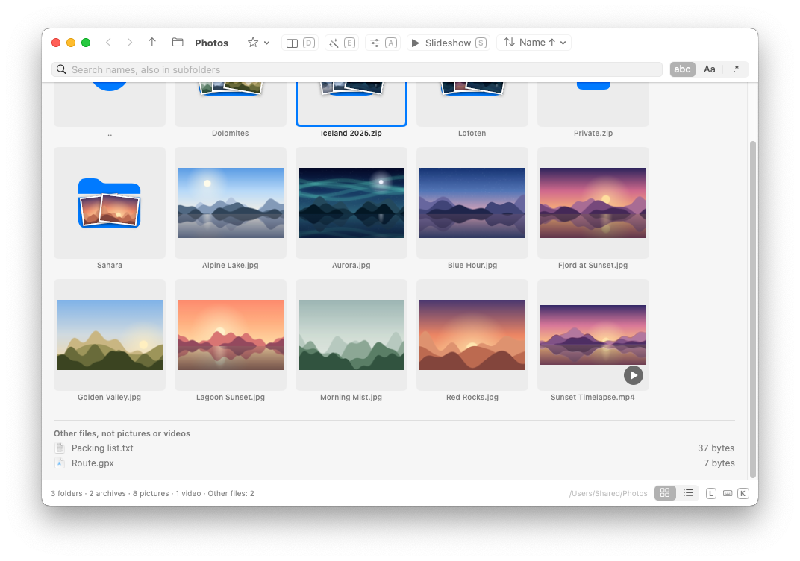
</picture>

<picture>
  <source media="(prefers-color-scheme: dark)" srcset="docs/screenshots/archive-inside-dark.png">
  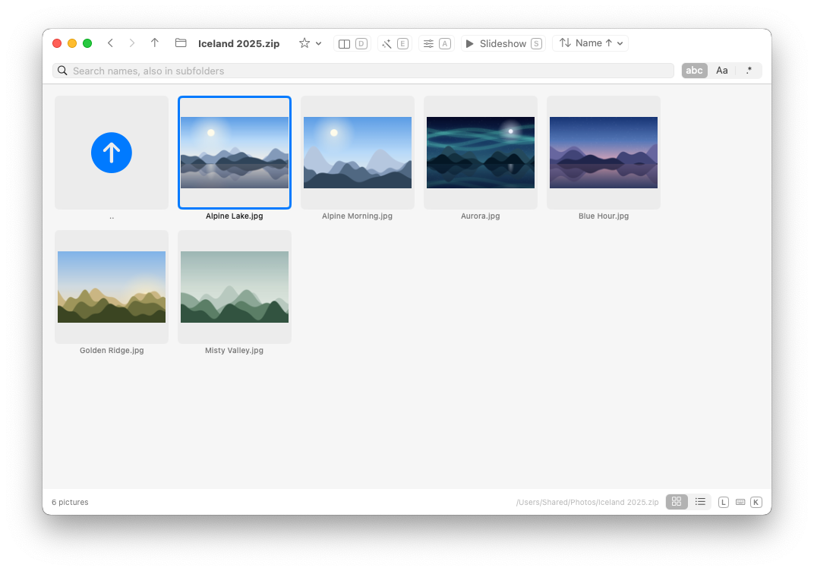
</picture>

<picture>
  <source media="(prefers-color-scheme: dark)" srcset="docs/screenshots/password-dark.png">
  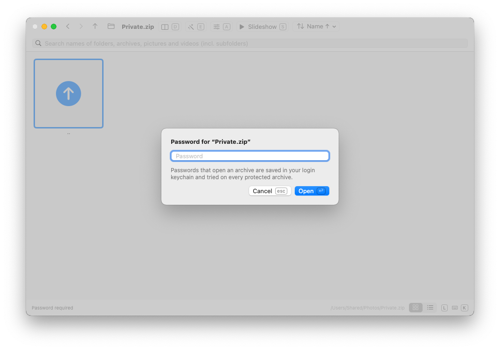
</picture>

### All keys at hand

<picture>
  <source media="(prefers-color-scheme: dark)" srcset="docs/screenshots/help-dark.png">
  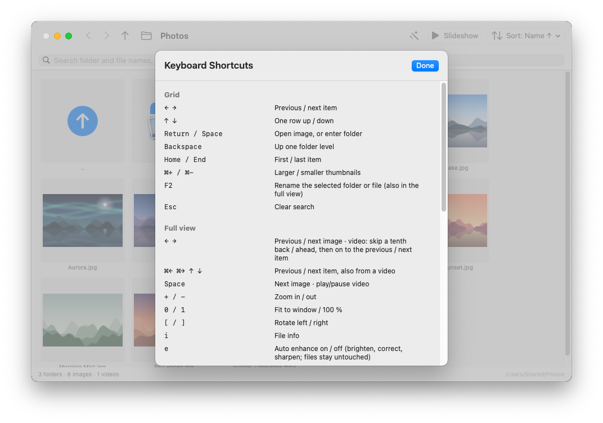
</picture>

F1 (or ⌘?) shows a cheat sheet of the keys; Print… (⌘P) in it prints it on one page, or saves it as a PDF. `K` (or View → Mini Keyboard, or the keyboard switch in the status bar) slides up the **mini keyboard** under the window: the keys that work on what's on screen right now (the grid, a picture, a video, the slideshow), each with what it does. It is a cheat sheet you can click, handy with only a trackpad; a key you press on the real keyboard lights up on it, so you see what just happened. In a slideshow it shows while you move the mouse. The action buttons (Dual Pane, Auto Enhance, Adjust, Slideshow, Grid) show their key on the button; the others name it in their tooltip.

<picture>
  <source media="(prefers-color-scheme: dark)" srcset="docs/screenshots/keyboard-dark.png">
  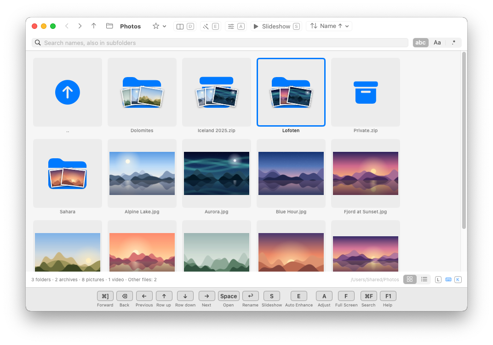
</picture>

### Settings

<picture>
  <source media="(prefers-color-scheme: dark)" srcset="docs/screenshots/settings-dark.png">
  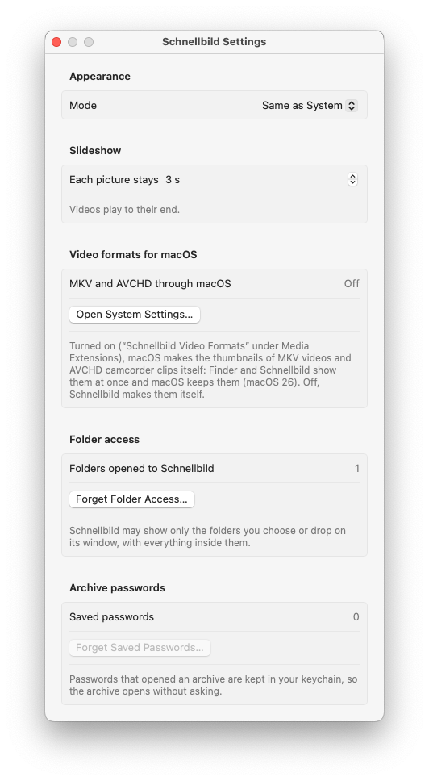
</picture>

Schnellbild → Settings (⌘,) has three things: how long a picture stays in the slideshow (1 to 60 seconds), whether macOS reads MKV itself (the media extension, with a button to System Settings), and the archive passwords Schnellbild has saved, which you can forget all at once. Everything else it simply remembers: the folder, the sort order, grid or list, the search mode, the dual pane, the mini keyboard, the volume, the bookmarks. Quitting while files are still being copied or moved asks first and can wait until they are done.

### Supported file formats

**Pictures** (shown with macOS' own ImageIO, so a newer macOS can read more):

| | Formats |
|---|---|
| Photos and graphics | JPEG (`.jpg`, `.jpeg`, `.jpe`), HEIC / HEIF (`.heic`, `.heif`, `.hif`, `.heics`), AVIF, JPEG XL (`.jxl`), PNG, GIF, WebP, TIFF (`.tif`, `.tiff`), BMP, JPEG 2000 (`.jp2`, `.j2k`), MPO |
| Vector and documents | SVG, PDF (every page as a vector picture) |
| HDR and editing | OpenEXR (`.exr`), Radiance (`.hdr`), Photoshop (`.psd`), Targa (`.tga`), DDS, icons (`.ico`, `.icns`) |
| Camera RAW (the models macOS knows) | Canon `.cr2` `.cr3` `.crw`, Nikon `.nef` `.nrw`, Sony `.arw` `.sr2` `.srf`, Fujifilm `.raf`, Olympus / OM `.orf`, Panasonic / Leica `.rw2` `.rwl` `.raw`, Pentax `.pef`, Samsung `.srw`, Hasselblad `.3fr` `.fff`, Phase One `.iiq`, Adobe `.dng`, Epson `.erf`, Kodak `.dcr`, Leaf `.mos`, Minolta `.mrw` |

Animated GIF, PNG and WebP play. RAW files show their built-in preview as a tile and are developed by macOS in the full view.

**Videos:**

| | Formats | Plays through |
|---|---|---|
| What macOS plays | MP4, MOV (`.mov`, `.qt`), M4V, 3GP / 3G2 | AVKit |
| Everything else | MKV, WebM, AVI, WMV, FLV, Ogg video (`.ogv`), MPEG (`.mpg`, `.mpeg`, `.m2v`), DVD video (`.vob`), AVCHD (`.mts`, `.m2ts`), DV | VLC, built in |

`.ts` isn't listed: far more such files are TypeScript code than video. Thumbnails in the Finder for these videos: see [Finder previews for more videos](#finder-previews-for-more-videos).

**Archives** (opened like folders, see [Archives as folders](#archives-as-folders)): ZIP and comic books (`.zip`, `.cbz`), RAR (`.rar`, `.cbr`, all versions, also in volumes `.part1.rar` … and `.rar` / `.r00` …), 7z (`.7z`, `.cb7`), and archives split by bytes (`.zip.001`, `.7z.001`) or as ZIP volumes (`.z01` …). Still downloading (`.part`, `.crdownload`, `.download`, `.partial`, `.!qb`), they open with what is there so far.

**Everything else** is listed by name and size under the grid; documents among it open with their app on a double click.

## A free Phiewer alternative

[Phiewer](https://phiewer.com/) is a good image viewer for the Mac and was the model for Schnellbild's keyboard-first browsing. If you are looking for a free, open-source alternative to Phiewer, this is how the two compare. Phiewer's side is what [phiewer.com](https://phiewer.com/) lists (as of November 2026) and what we found using it; "not listed" means the site doesn't mention it.

| | Schnellbild | Phiewer |
|---|---|---|
| Price | free, open source (MIT), no pro version | lite free; PRO a one-time purchase |
| macOS | 15 and later | 15 and later |
| Grid, full view, slideshow through subfolders | yes | yes |
| Search | names of folders and files, all subfolders | name, tags, comments, date, EXIF |
| ZIP, RAR and 7z archives as folders (also with passwords) | yes | no |
| MKV, WebM and other formats macOS can't play | yes (built-in VLC engine) | not listed (MP4, MOV, AVI, MPG, 3GP, MTS, TS …) |
| Two panes side by side, Norton Commander keys | yes | no |
| Auto enhance and sliders for photos and videos | yes, as a view: files are never changed | edits with filters and undo; crop in PRO |
| Audio files, Finder tags, export, printing pictures | no | yes |
| Your own keyboard shortcuts | no (F1 shows every key) | yes (in PRO) |

## Why so fast?

1. **Riding on the system.** Thumbnails come from Apple's QuickLook (`QLThumbnailGenerator`). It pulls **embedded previews** (EXIF thumbnail, JPEG in RAW): a few KB instead of tens of MB over the network. QuickLook keeps the thumbnails in the system's own cache on your Mac, for folders on network shares too. For many videos QuickLook can't read itself (MKV, WMV, FLV, VOB …), Schnellbild brings a QuickLook extension: VLC takes a frame, macOS keeps it like any other thumbnail, so such a video is read once, not on every visit (see [Finder previews for more videos](#finder-previews-for-more-videos)). Schnellbild also keeps the thumbnails of the session in memory (up to an eighth of the Mac's memory), so scrolling back through thousands of search results asks no one again.
2. **Lazy and parallel.** The grid only loads the tiles on screen, and the system runs thumbnail generation in parallel.
3. **Full view downsampled.** The full picture is read through ImageIO and sampled straight to screen size, no 8000 px monster in memory. The thumbnail shows instantly as a placeholder.
4. **Nothing blocks the main thread.** Reading folders, searching and decoding run in the background.

## Building

Building from source, tests and releases: [BUILDING.md](BUILDING.md).

## License

[MIT](LICENSE) © 2026 HAUS HOPPE - ITS (Johannes Hoppe)

The MIT License covers Schnellbild's own code. The app also contains VLCKit (GNU LGPL 2.1 or later, some modules GNU GPL 2 or later), UnRAR (UnRAR license) and uses the libarchive built into macOS (BSD); each keeps its own license. Details, the source of VLCKit and the license texts: [THIRD-PARTY-NOTICES.md](THIRD-PARTY-NOTICES.md) and the app's About window.
